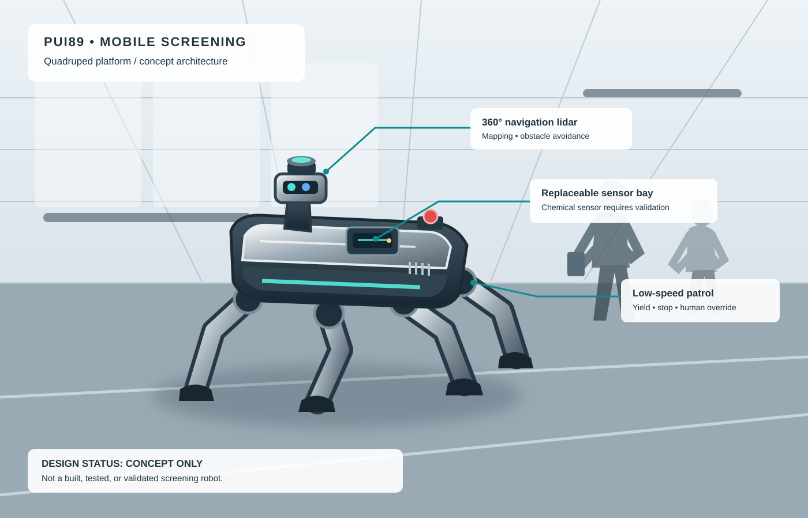

# Multimodal AI for Intelligent Narcotics Screening and Robotic Inspection

## Free-first offline engineering tools

- **Free robotics stack selection:** [open-source systems, licence notes and adoption gates](docs/FREE_ROBOTICS_STACK_ADOPTION.md). These are recommendations only; no robotics packages or model weights are installed or downloaded by this PR.
- **Phased autonomy lab:** [test and simulation guide](docs/PUI89_AUTONOMY_LAB.md); runner: `tools/pui89_autonomy_lab.py`; project scenarios: `simulation/scenarios.json`. Includes logged world-state snapshots, safe-hold/UNKNOWN mock VLA gates, reproducible JSON/CSV reports and an offline model-resource preflight. No model is downloaded or installed automatically; no hardware is controlled.

- Free offline evidence-provenance validation and human-review routing: `scripts/free_first_project_tools.py`; tests: `tests/test_free_first_project_tools.py`. Outputs do not identify substances or establish guilt.
- Dependency-free precision, recall, F1 and confusion counts support later evaluation; no substance-identification or enforcement claims are implied.

## Frontier AI technology and free-first upgrade plan

Current gaps, recent technology directions, no-recurring-cost adoption gates, and project-specific next steps: [Frontier technology gap and free-first plan](docs/FRONTIER_TECHNOLOGY_GAP_AND_FREE_PLAN.md). No large model or simulator is installed automatically; verify licences, download size, hardware fit and costs first.

**Robot product name: PUI89 Sentinel**

A research-and-development project exploring how computer vision, suitable inspection imagery, validated sensor outputs, and robotic assistance could support lawful, human-reviewed security screening.

## Project at a glance

- **Project topic:** Multimodal AI for Intelligent Narcotics Screening and Robotic Inspection.
- **Robot name:** PUI89 Sentinel — a proposed mobile inspection assistant, not a built or validated robot.
- **AI role:** Analyse permitted inputs, identify visible patterns or sensor anomalies, communicate uncertainty, and help trained staff decide what needs further inspection.
- **Possible modalities:** RGB imagery and, when suitable licensed data and equipment are available, X-ray imagery and validated chemical-sensor outputs. Each modality needs its own evaluation.
- **Safety rule:** An AI alert is not proof of narcotics. No autonomous accusation, detention, search, or enforcement decision; consequential actions require authorised human review and applicable lawful procedures.
- **Development approach:** Free-first and local-first where feasible; document model licenses, data provenance, limitations, and reproducible tests.
- **Evidence status:** Exploratory software and concepts only. No validated narcotics-detection performance or physical-robot capability is claimed.

---


## Current verified status — 25 October 2026

**Stage:** local visual experiments, concept/simulation work and software regression testing. This repository does not demonstrate a validated physical screening robot or validated narcotics detector.

- **SAM 3 segmentation:** the optional local smoke-test script and guide are merged ([PR #35](https://github.com/Pui89/Multimodal-Narcotics-Screening-AI/pull/35)). No SAM 3 inference result has been verified yet. Model weights are downloaded only when the script is run; check compatibility, access terms, disk space and GPU memory first.
- **Automated checks for the SAM 3 change:** Python tests, security checks, Ruff helper review and local-first app regression checks completed successfully for the change's pull-request commit. These checks do not establish screening accuracy.
- **Open review:** the shared fault-monitor contract remains a draft proposal in [PR #34](https://github.com/Pui89/Multimodal-Narcotics-Screening-AI/pull/34); it is not merged into the default branch.
- **Next:** run one local visible-item segmentation smoke test; assess whether masks align with packages, bags or containers; then define licensed test data and a human-reviewed evaluation protocol for each proposed sensor modality.
- **Critical limit:** ordinary RGB imagery and generic segmentation cannot prove concealed narcotics or chemical composition. Any future alert requires validated, appropriate sensing and lawful human review; no automatic accusation or enforcement decision is supported.


## Mobile quadruped screening robot — people, carry-on items, and ambient-air sampling



[View the complementary multimodal screening-system concept illustration](docs/images/multimodal-screening-robot-concept-2026.svg).

**Concept only — not a built or validated robot.**

The proposed system is a four-legged, dog-inspired mobile platform designed to move through an authorised terminal screening zone rather than remain fixed at a baggage conveyor. It can navigate around people who are walking, pause at a safe distance, observe permitted screening zones, and sample ambient air near a person or item when an authorised operator requests a secondary check.

## Optional local visual anomaly baseline

A separate exploratory tool compares a local image with a reference set using Hugging Face DINOv2 image embeddings and reports an image-level distance score. It is a generic visual outlier baseline, **not a concealed-object detector**, narcotics detector, or chemical identifier. Ordinary RGB images cannot reveal objects hidden under clothing. See [the anomaly baseline guide](docs/HUGGINGFACE_VISUAL_ANOMALY.md), [the staged concealed-object roadmap](docs/CONCEALED_OBJECT_SCREENING_ROADMAP.md), and [the script](tools/huggingface_visual_anomaly_baseline.py).

## Optional local Hugging Face visible-item experiment

Try open-vocabulary detection of generic visible items on a local image with [`tools/huggingface_local_vision_demo.py`](tools/huggingface_local_vision_demo.py). Read [`docs/HUGGINGFACE_LOCAL_VISION.md`](docs/HUGGINGFACE_LOCAL_VISION.md) first. This demo does not identify narcotics, infer chemical composition, score people, or make enforcement decisions.

### What the robot is intended to do

- **Move efficiently and safely:** quadruped legs, onboard obstacle sensing, adaptive speed, geofenced routes, and an emergency stop. The robot may move faster only in a validated, clear area; it must slow near people, yield to pedestrians, never chase or physically block anyone, and stop safely if localisation or obstacle sensing becomes unreliable. Speed is limited by stability, braking distance, floor conditions, and validated hardware.
- **Screen beyond bags:** support an authorised workflow for people moving through a terminal, carry-on items, and the surrounding air. The robot does not touch, restrain, follow covertly, or make a judgement about a person.
- **Use distinct sensing systems for distinct jobs:** lidar/depth sensing maps obstacles and estimates distance; RGB/low-light cameras support permitted scene understanding; an optional, separately validated chemical-vapour or trace-residue sensor may screen air or approved samples. These systems do not reveal narcotics hidden inside a person. A dog-like form does not provide a biological sense of smell: chemical detection requires suitable hardware, calibration, controlled sampling, and independent validation.
- **Alert a trained human:** show sensor status, confidence/uncertainty, and the reason for a screening alert. An alert means *check this result using an approved procedure*—not “this person has narcotics.” Only authorised staff decide whether a lawful secondary inspection is appropriate.
- **Protect people and data:** minimise and time-limit video retention, avoid face recognition and demographic profiling, log operator access, use encrypted communications, and provide visible notice and an accessible human review route. Do not autonomously accuse, detain, search, or report a person based on an AI score.

### Range, concealed items, and screening limits

- **What is far away:** lidar, radar, and cameras can support navigation, distance measurement, and detection of visible objects within their tested range. They cannot identify narcotics at a distance.
- **What is concealed under clothing:** only an appropriately approved screening system designed for that purpose—such as a certified millimetre-wave body scanner in a lawful, staffed screening checkpoint—may be considered. It is a separate subsystem with its own safety, privacy, regulatory, and performance validation; ordinary robot cameras and lidar cannot do this.
- **What may be inside the body:** this mobile robot must not claim to detect narcotics inside a person's body. That is not a capability established by this concept. Any medical or specialised screening is outside the robot's role and must follow applicable law and qualified professional procedures.
- **How an alert is handled:** a sensor anomaly is only a reason for an authorised human operator to follow an approved secondary-screening procedure. It is not proof that a person is carrying narcotics. No covert tracking, automatic accusation, detention, or enforcement decision based on an AI score.

## Video concept and interactive 4D-style simulation

**Start here — playable cinematic concept:** open the [PUI89 Quadruped Airport Robot — Cinematic Concept](docs/demos/quadruped-screening-robot-cinematic-concept.html). This free, self-contained browser animation presents a 75-second concept sequence with play/pause, restart, timeline scrubbing, and shot selection: terminal establishing shot, four-leg gait, adaptive speed, pedestrian yielding, spatial-awareness overlays, a conceptual scan graphic, an inconclusive simulated alert, and authorised human review. It uses Canvas with no external library, paid API, or cloud GPU. **It is an animated concept preview, not an exported MP4 or real footage.**

**Video production plan:** read the [PUI89 robot video storyboard](docs/demos/quadruped-screening-robot-video-storyboard.md) for the 60–75 second shot list, visual direction, and production notes.

**Interactive 4D-style simulation:** open the [Quadruped Autonomy Lab](docs/demos/quadruped-robot-autonomy-lab.html). Here, “4D-style” means a time-evolving interactive 3D scene—not a validated physics-based digital twin. The browser lab includes an animated articulated quadruped, synthetic airport passengers, rule-based adaptive speed and pedestrian yielding, sensor-style overlays, telemetry, event logging, and simulated fault scenarios. It uses the free Three.js library via a public CDN, so internet is required. No paid API or cloud GPU is required. Navigation is rule-based, not a trained AI model, and fault responses are illustrative rather than verified safety performance.

**Step 2 — Interactive true-3D concept:** open [Quadruped Airport Digital Twin](docs/demos/quadruped-screening-robot-true-3d.html). It uses the free Three.js library via a public CDN to render a perspective 3D terminal, a procedural four-leg robot gait, synthetic walking passengers, orbit/zoom camera controls, adaptive rule-based speed, pedestrian yielding, a sensor-overlay visual, and a simulated anomaly that pauses the robot for human review. **Internet is required to load Three.js; there is no paid API or cloud GPU requirement.** The navigation logic is a transparent rule-based demonstration, not a trained AI model or validated autonomy stack.

**Step 3 — Autonomy and fault-injection lab:** open the [Quadruped Autonomy Lab](docs/demos/quadruped-robot-autonomy-lab.html). This expanded WebGL concept adds articulated gait animation, a synthetic pedestrian field, rule-based predictive yielding, adaptive speed, a lidar-style visualization, live telemetry, an event log, and simulated lidar-dropout, communication-loss, and emergency-stop scenarios. It uses Three.js from a free public CDN and therefore needs internet access. Fault responses are illustrative software behaviour—not verified safety performance.

**Step 4 — Lightweight fallback:** the [2D browser simulation](docs/demos/quadruped-screening-robot-3d-concept.html) runs as a simple Canvas perspective animation. The [earlier movement demo](docs/demos/quadruped-screening-robot-simulation.html) is also available.

> **Concept only — not validated:** all people and sensor effects are synthetic. Chemical detection is conceptual and unvalidated; these demos do not detect real narcotics, identify people, screen under clothing, or detect substances inside the body. An alert is inconclusive and must be reviewed by authorised personnel under an approved procedure. No facial recognition, demographic profiling, automatic accusation, detention, or enforcement decision is demonstrated.

### Recommended advanced improvements and development roadmap

The following are proposed improvements, not claims that the capabilities already exist.

#### Priority engineering improvements

1. **360-degree spatial awareness:** combine lidar, depth sensing, inertial measurements, and mapping for obstacle distance and navigation. Detect sensor disagreement and stop safely when the robot cannot estimate its surroundings reliably.
2. **Dynamic pedestrian safety:** adapt speed to available space, yield to people, maintain a safe separation, and test sudden obstacles, crowded corridors, and emergency stops in simulation. Faster movement is permitted only within validated safe operating limits.
3. **Self-monitoring and fault recovery:** monitor battery, motor temperature, localization, sensor health, and communications. On a critical fault, stop safely, report the fault, and request human assistance.
4. **Modular chemical-sensor interface:** define a replaceable interface for an appropriately selected vapour or trace-residue sensor. Track calibration, environmental conditions, sensor health, false alarms, and missed detections. No sensor is selected or validated yet.
5. **Privacy-preserving operation:** prefer local processing where practical, minimise video retention, use access controls and audit logs, and avoid facial recognition or demographic profiling. Screening must be lawful, transparent, and supervised by trained staff.
6. **Digital twin and simulation:** create a simulated terminal with synthetic walking pedestrians, luggage, obstacles, restricted zones, and sensor-failure scenarios. Test safety before any physical deployment.
7. **Cooperative fleet (later phase):** explore multiple robots sharing authorised zone maps and coordinating patrol routes, with collision avoidance, communications-loss handling, and human supervision.
8. **Automated verification and evidence:** publish repeatable test results for navigation success, stopping distance, pedestrian yielding, recovery from faults, energy use, latency, false alarms, and missed detections. Label every result as simulated or physically measured.

#### Advanced capabilities to explore later

- **Event-triggered sensing:** collect only the data required for an authorised screening step, rather than continuously collecting unnecessary personal data.
- **Uncertainty-aware AI:** allow an explicit “inconclusive — human review required” result rather than forcing a positive or negative decision.
- **Local edge computing:** keep time-critical navigation and safety functions operational without relying on a cloud connection.
- **Safe return and recovery:** test blocked-route, low-battery, and lost-communications behaviours, including safe stopping and requesting assistance.
- **Maintenance monitoring:** use logged component-health measurements to plan maintenance; do not claim predictive accuracy until evaluated.
- **Accessible operator controls:** provide clear status indicators and a reliable manual stop, pause, and handover workflow.

#### Concealed-item and chemical-screening boundaries

- Cameras, lidar, and ordinary depth sensors support visible-scene understanding and navigation; they **cannot identify narcotics at a distance or see through clothing**.
- A suitable, approved body-scanning system for concealed objects under clothing would be a separate regulated subsystem, requiring its own legal, privacy, safety, and performance review. It cannot by itself establish that an object is narcotics.
- This concept does **not** claim to detect drugs inside a person's body. That is outside the established capabilities of this mobile robot.
- Any sensor anomaly is a screening lead for an authorised, trained human to assess under approved procedures—not proof of wrongdoing. No covert following, automatic accusation, detention, or enforcement decision based solely on an AI score.

#### Implementation phases

| Phase | Deliverable | Cost approach |
|---|---|---|
| 1 | Architecture, requirements, sensor interfaces, and safety criteria | Free-first design |
| 2 | Local quadruped/robot simulation with synthetic pedestrians and obstacles | Free local tools where feasible |
| 3 | Automated navigation, pedestrian-yielding, fault, and emergency-stop tests | Free local tools where feasible |
| 4 | Chemical-sensor interface specification and controlled evaluation plan | Design first; no hardware purchase yet |
| 5 | Physical prototype and authorised pilot after cost, safety, and privacy review | Requires separate approval and budget |

**First implementation milestone:** build and test a local simulation featuring adaptive speed, pedestrian avoidance, safe stopping, fault handling, and repeatable automated tests. No simulation result should be presented as evidence of physical robot performance or reliable narcotics detection.

### Proposed physical architecture

| Subsystem | Proposed implementation | Evidence status |
|---|---|---|
| Mobility | Commercial quadruped base or a small research quadruped; speed limited by validated safe operating zones | Design proposal; no robot built or tested is claimed |
| Navigation | 3D lidar/depth camera, IMU, wheel/leg odometry where available, mapping and obstacle avoidance | To be integrated and tested |
| Scene sensing | RGB camera and depth sensor aimed at the environment, not used to infer guilt | Hardware and privacy review required |
| Chemical screening | Replaceable, validated vapour/trace sensor selected with qualified screening specialists | Not selected or validated; no chemical detection claim |
| Compute and communications | Local edge computer, encrypted operator link, physical emergency stop, battery and thermal monitoring | Proposed |
| Human interface | Alert review, sensor health, audit log, uncertainty display, manual override | Software workflow prototype is separate from physical integration |

### Safe development sequence

1. Build a **non-enforcement mobility demonstrator** in a simulated terminal, with walking-person obstacles represented by synthetic agents.
2. Verify stopping distance, pedestrian yielding, stability, battery/thermal behaviour, emergency stop, communication-loss handling, and privacy controls.
3. Bench-test a selected chemical sensor only with lawful, controlled reference materials and qualified facilities; document detection limits, environmental interference, false alarms, and missed detections.
4. Run an authorised, independently reviewed pilot with clear notice, trained operators, and a manual secondary-screening process. Publish measured results and limitations before making performance claims.

**Current status:** this is a proposed product architecture and concept illustration. The repository's existing software workflow and automated tests do not establish that a physical quadruped exists, that a chemical sensor is integrated, or that narcotics can be reliably detected from a person or their surroundings. Do not use the system for covert surveillance or as the sole basis for enforcement.


## Project at a glance

| Topic | Current position |
|---|---|
| Project type | Multimodal sensor-processing and screening-workflow research prototype |
| Available software | Local dashboard/API and rule-based decision support, input validation, evaluation utilities, and regression tests |
| Sensor integration | The software can represent and review multiple modality inputs; validated real-sensor fusion is not established |
| Screening performance | No representative independent real-data benchmark establishes reliable narcotics detection or chemical identification |
| Safety and privacy boundary | Outputs are screening signals for authorised human review, never proof of substance identity or wrongdoing; no automatic enforcement decision |
| Development approach | Local-first, privacy-conscious, and free/open-source where practical |
| Immediate focus | Use lawful, appropriately licensed and expert-reviewed data; test missing/conflicting/noisy inputs; measure false positives, false negatives, calibration and human-review routing |

**Explore:** [Complete-system blueprint](docs/COMPLETE_SYSTEM_BLUEPRINT.md) · [Validation matrix](docs/VALIDATION_MATRIX.md) · [Evaluation guide](docs/EVALUATION.md) · [Automated tests](https://github.com/Pui89/Multimodal-Narcotics-Screening-AI/actions)

## Local fault-monitoring software (initial implementation)

A small, dependency-light Python module accepts explicit fault reports, suggests conservative responses, and keeps a bounded in-memory event log. It includes automated unit tests and a GitHub Actions test workflow. It is not an antivirus, intrusion detector, gunshot detector, or physical safety controller; hardware shutdown, persistent audit storage, alerts, and real-world threat detection require separate implementations and validation.

- [Fault monitor integration guide](docs/FAULT_MONITOR_INTEGRATION.md)
- [Fault monitor source](apps/pui89_safety/fault_monitor.py)
- [Fault monitor tests](tests/test_fault_monitor.py)


## Fail-safe operating modes (screening workflow design)

The screening application and proposed robotic system should use three modes: **AI operation**, **limited safe operation**, and **manual recovery**. The system must never treat an AI output as proof that a person is guilty or that a substance has a specific chemical identity based only on appearance.

- **AI operation:** models may flag items for further review, with uncertainty and supporting evidence shown to a trained human reviewer.
- **Limited safe operation:** if a model, camera, sensor, or data source fails, stop automated classification and preserve only safe functions such as status display and diagnostic logging. Do not generate new screening conclusions from missing or unreliable inputs.
- **Manual recovery:** an operator takes over, checks the equipment and data, and resumes only after the fault is resolved.

**Status and limitation:** these are software/product design requirements, not a claim that a trained detector or validated physical screening robot exists. Preserve privacy, auditability, human review, and applicable legal procedures.

- [System fault, hardware, electrical, and recovery playbook](docs/SYSTEM_FAULT_AND_HARDWARE_SAFETY.md)

## Project status — 22 October 2026

**Current stage:** local-first rule-based screening workflow and software regression testing; not a trained narcotics detector or chemical-identification system.

- **Verified CI:** the latest Python tests, agent unit tests, multimodal regression checks, and local-app regression checks completed successfully. [Latest regression-check run](https://github.com/Pui89/Multimodal-Narcotics-Screening-AI/actions/runs/39729390362) · [Latest local-app regression run](https://github.com/Pui89/Multimodal-Narcotics-Screening-AI/actions/runs/39729390278).
- **Implemented:** workflow checks for authorization, modality-record completeness, conflicting inputs, and human review.
- **Next milestone:** define one narrow, authorised task; document lawful data sources and ground-truth provenance; test missing/conflicting/uncertain inputs; and evaluate false positives, false negatives, and expert-review outcomes on independent expert-reviewed data.
- **Limits:** images alone cannot establish chemical identity or criminality. No validated narcotics-detection claim is made, and AI output must not independently trigger enforcement action.


## Free decision-support agent (current scope)

**Additional cost for this rule-based agent: $0.** It uses the repository's Python code and supplied inputs; it does not require a paid AI API, cloud service, or model download. Local Python/test tooling and GitHub usage remain subject to their own terms and limits.

**What it does:** Checks supplied modality records, authorisation, conflicting inputs, and human review. It does not identify chemicals or infer criminality from appearance.

```text
Authorised case inputs → completeness and conflict checks → human review → documented decision
```

- **Run guide:** [Agent guide](docs/AGENT_GUIDE.md)
- **Important limitation:** this is a rule-based decision-support prototype, not proof of real-world performance. Hardware, optional third-party services, or future model training may have separate costs.


> **Product quality standard:** [benchmark protocol and fair comparison criteria](docs/PRODUCT_BENCHMARK_STANDARD.md). This workflow prototype is **not validated** for narcotics detection or chemical identification. Appearance alone cannot establish chemical identity; no validated identification claim is made.

> **Next research milestone — controlled evaluation:** define one narrow, authorised screening task and its ground-truth source; document which modalities are genuinely available; test missing, conflicting, and uncertain inputs; and report false positives, false negatives, and human-review outcomes on independent, expert-reviewed data. Until such data and validation exist, the dashboard remains a manually populated workflow prototype—not a trained narcotics detector or chemical-identification system. See the [validation matrix](docs/VALIDATION_MATRIX.md).


## Run the agent tests

Run the focused, lightweight unit tests locally with Python 3.10 or newer:

```bash
python -m pip install pytest
python -m py_compile agents/project_agent.py tests/test_project_agent.py
python -m pytest -q tests/test_project_agent.py
```

A dedicated [GitHub Actions workflow](https://github.com/Pui89/Multimodal-Narcotics-Screening-AI/actions/workflows/agent-tests.yml) is configured to run the agent tests on Python 3.10, 3.11, and 3.12 when relevant files change. Check the Actions page for the actual run status; adding this workflow does not itself mean the tests have passed.

## Support, sponsorship and open-source collaboration

PUI89 welcomes open-source contributions, multimodal evaluation expertise, authorised data-governance guidance, independent technical review, and scoped research or sponsorship discussions.

- **Support and sponsorship brief:** [ways to collaborate with PUI89](https://github.com/Pui89/Pui89.github.io/blob/main/SUPPORT_AND_SPONSORSHIP.md)
- **Project website:** [PUI89 AI Robotics](https://pui89.github.io/)

Any data or testing proposal must be authorised, privacy-reviewed, and legally appropriate. Outputs are decision-support research only; images alone cannot establish chemical identity, and AI must not independently trigger enforcement action.

## Latest engineering update — 21 October 2026

- **Safety input validation:** [PR #14](https://github.com/Pui89/Multimodal-Narcotics-Screening-AI/pull/14) is merged. The software gate rejects malformed thresholds and invalid navigation inputs rather than treating ambiguous values as safe.
- **Automated checks:** the two GitHub Actions workflows for the PR passed before merge.
- **Evidence boundary:** these checks establish software input-validation behavior only. They do not validate a narcotics detector, prove chemical identity, or establish physical robot safety. Real held-out data and authorized expert-reviewed labels are still needed before reporting detector performance.

## Thailand case reference: hashish seizure in Bangkok (reported 6 November 2024)

Thai PBS World reported that Thai anti-narcotics police arrested two foreign nationals, described as British and Dutch, at a rented condominium in Bangkok and seized **36 kg of dried cannabis and 1.4 kg of hashish**. The report said documents found at the location indicated plans to mail packages to England. This is a reported law-enforcement case, not a claim of a court finding or conviction.

- **Source:** [Thai PBS World — Two foreigners arrested in Bangkok preparing to ship 36kg of weed to the UK](https://www.thaipbsworld.com/crime/two-foreigners-arrested-in-bangkok-preparing-to-ship-36kg-of-weed-to-the-uk) (6 November 2024).
- **Relevance to this project:** this case can inform discussion of authorised screening workflows, evidence provenance, and human review. It is **not** a model-training example or a validated benchmark item; no case-specific image or verified ground-truth dataset is included here.
- **Important limitation:** photos of cannabis or hashish cannot establish chemical identity. Any future evaluation would require lawfully obtained, appropriately licensed data and expert-confirmed labels, with independent test splits and false-positive/false-negative reporting. AI output must remain decision support for authorised human reviewers and must not independently trigger enforcement action.


## Real-world screening case references

These publicly reported Thailand cases provide context for research into screening, secondary inspection, evidence provenance, and confirmatory testing. They are **case references only**—not model-training samples, benchmark records, or evidence that this prototype can detect the substances described.

### Case 1 — Phuket Airport: reported methamphetamine seizure (February 2025)

*The Nation Thailand* reported that airport X-ray screening flagged a suitcase for further inspection; authorities then reported finding concealed packages and confirming methamphetamine through chemical testing.

- **Source and report photographs:** [The Nation Thailand — Phuket airport seizure report](https://www.nationthailand.com/news/general/40046654)
- **Research relevance:** illustrates a layered workflow in which an initial screening alert is followed by inspection and confirmatory testing.

### Case 2 — Phuket Airport: reported heroin seizure (July 2025)

Thailand's Tourist Police reported that an X-ray prompted further luggage inspection and that suspected heroin was found concealed in product packaging.

- **Source and report photographs:** [Tourist Police Bureau — case report](https://www.touristpolice.go.th/post/tpbnews2025071801)
- **Research relevance:** illustrates secondary inspection after an initial screening alert. Refer to the authority's wording when describing the substance and case status.

### Photograph, licensing, and evidence rules

The reports above link to their original pages, where case photographs may be available. **No third-party photograph is embedded or copied into this repository in this section**, because reuse permission and the exact image provenance have not been independently verified. Check the source's licence or obtain permission before reproducing an image; otherwise link to the source page and credit it.

These reports do not validate this project's software. A photograph alone cannot confirm chemical identity, and an X-ray screening alert is not equivalent to chemical identification. Any future AI evaluation requires lawful and appropriately licensed data, documented provenance, suitable ground truth, independent held-out testing, false-positive/false-negative reporting, and authorised human review. AI output must not independently trigger enforcement action.

## Potential future screening categories — not yet implemented

The categories below are possible future research scopes, not current model capabilities or confirmed training labels:

- **Dried cannabis** — dried plant material.
- **Hashish / cannabis resin** — a resin-derived cannabis product; keep it distinct from dried plant material in any annotation scheme.
- **Methamphetamine**
- **Cocaine**
- **Heroin**

**Implementation and evidence status:** these are proposed categories only. The repository does not claim that a trained model can detect or identify these substances. Do not label photographs as confirmed substances based on appearance alone. Any future dataset must be lawfully obtained, appropriately licensed, provenance-documented, and labelled using suitable analytical evidence and qualified expert review. Evaluate each class on independent held-out data and report false positives, false negatives, uncertainty, and human-review outcomes before making performance claims.

**Image policy:** prefer linking to the original official or reputable source unless image reuse permission is confirmed. Clearly distinguish illustrative case photographs from model-training data and benchmark samples.

> **Complete-system architecture and acceptance gates:** [COMPLETE_SYSTEM_BLUEPRINT.md](docs/COMPLETE_SYSTEM_BLUEPRINT.md). This is a build-and-validation plan, not a claim of validated narcotics identification.
> **Current validation matrix:** [VALIDATION_MATRIX.md](docs/VALIDATION_MATRIX.md) — implementation evidence, automated checks, and remaining unvalidated capabilities.
> **Engineering assurance plan:** [ENGINEERING_ASSURANCE_PLAN.md](docs/ENGINEERING_ASSURANCE_PLAN.md) — project requirements, hazard log, verification/validation gates, and evidence rules.

## Local Hugging Face model plan

This repository's recommended local model, intended tasks, licence checks, setup notes, and no-surprise-billing rules are documented in **[HUGGINGFACE_LOCAL_MODELS.md](docs/HUGGINGFACE_LOCAL_MODELS.md)**.

**Cost boundary:** the plan uses downloaded local weights only; it does not require paid Hugging Face inference, cloud GPUs, paid notebooks, or a subscription. Model integration and performance must be verified by running tests locally.

**Dataset and labelling workflow:** see [dataset sources, licence checks, annotation and training plan](docs/DATASET_ACQUISITION_AND_LABELING.md), the [Windows opt-in dataset helper](scripts/prepare_free_datasets.ps1), the [image inventory/manifest generator](tools/dataset_inventory.py), the [manifest template](data/manifest.template.csv), the [group-aware train/validation/test splitter](tools/group_split_manifest.py), and the [local manifest audit tool](tools/audit_dataset_manifest.py). Downloads require local user confirmation; no images are automatically considered licensed or correctly labelled. Keep datasets and weights out of Git.

[Detailed project status, checks, next steps and future plan](docs/PROJECT_STATUS_2026-10-18.md)

[Product brief and release gates](docs/PRODUCT_BRIEF.md)

## Latest automated CI verification — 20 October 2026

The latest local-first regression workflow passed on the current main-branch change in [run 39276822504](https://github.com/Pui89/Multimodal-Narcotics-Screening-AI/actions/runs/39276822504). It checks API/evaluation software, dataset-manifest safeguards, and the synthetic evaluation pipeline. Synthetic test results are not real screening benchmarks and do **not** establish narcotics identification or chemical identity.

## Latest status update — 20 October 2026

- **Current status: screening workflow prototype; not a validated narcotics detector.** The validation matrix was refreshed on 20 October to match [the latest passing CI run](https://github.com/Pui89/Multimodal-Narcotics-Screening-AI/actions/runs/39276822504). The tests verify software behavior only; synthetic scores are not real screening-accuracy results.
- **Data readiness:** obtain lawful, authorised, appropriately licensed and expert-reviewed data before model evaluation. Record provenance and annotation rules, prevent duplicate/source leakage across splits, and document which modalities are genuinely available and aligned.
- **Next checks:** test missing, stale and conflicting modalities; verify confidence calibration and the ability to abstain as `UNKNOWN`; compare single-modality baselines with multimodal fusion only when suitable aligned real data exist; report false positives, false negatives, calibration and failure cases.
- **Not yet demonstrated:** a trained model validated on a representative independent dataset, reliable chemical identification, validated multimodal sensor fusion, or a validated physical screening robot. Ordinary RGB images cannot establish chemical identity or reveal contents hidden inside closed luggage.
- **Human review and rights:** any screening output is a hypothesis for an authorised reviewer, not proof of a substance or grounds for automatic enforcement. Preserve privacy, auditability and documented review.
- **Cost boundary:** remain cost-conscious and local-first where feasible; local model plans do not mean that model integration or accuracy has already been verified.

## Previous status update — 18 October 2026

- **Successful:** Python CI passed on 3.10/3.11/3.12 in [run 39096448541](https://github.com/Pui89/Multimodal-Narcotics-Screening-AI/actions/runs/39096448541); local API/dashboard and synthetic evaluation checks are present. This does not establish narcotics-identification accuracy or chemical identity.
- **Continuing:** define the lawful task; check provenance/licences and labels; expand tests for missing/conflicting modalities, uncertainty, calibration and abstention to UNKNOWN/human review.
- **Next:** secure lawful, expert-reviewed data; prevent duplicate leakage; compare single-modality baselines with fusion only when suitable aligned data exist; report false positives/negatives and calibration.
- **Future:** test distribution shifts, sensor failure, privacy and auditability before any independently reviewed pilot.
- **Corrections:** synthetic test scores are not screening accuracy; pharmaceutical pill imagery is not proof of illicit-narcotics detection; images alone cannot confirm chemical identity. AI must not independently trigger enforcement action. Open-source-first.

## Project status overview — updated 18 October 2026

**Current stage: screening workflow prototype and evaluation-pipeline testing. Not a validated narcotics detector.**

| Status | What it means today |
|---|---|
| **Successful** | The latest GitHub Actions regression run passed on Python 3.10, 3.11 and 3.12. The evaluation runner validates records and confidence values; metric tests cover invalid inputs and calibration safeguards. |
| **In progress** | Making evaluation repeatable and documenting the data, annotation, and reporting requirements. |
| **Synthetic-only evidence** | The checked-in JSONL and report verify that the evaluation pipeline runs. They are not narcotics data, trained-model predictions, or real screening-performance results. |
| **Not yet demonstrated** | A trained detector validated on an independent, representative, lawfully obtained dataset; reliable chemical identification; deployment-ready multimodal fusion; or a validated physical screening robot. |
| **Next** | (1) Define a lawful, narrowly scoped intended use; (2) obtain appropriately authorized/licensed data; (3) document labels and independent splits; (4) evaluate a baseline and report per-class precision/recall, confusion matrix, false-positive/false-negative rates, abstention and calibration; (5) perform privacy, bias, security and human-review testing. |
| **Future** | Compare modalities only where real sensor data and lawful access exist; test distribution shifts and sensor failures; conduct independent expert review and controlled pilot evaluation before any operational claim. |

**Evidence boundary:** successful CI proves that the automated software checks passed—not that narcotics can be identified accurately. The application must present uncertain results as uncertain, require authorized human review, and never treat an AI score as proof of a substance's identity.


## Decision-support agent (rule-based prototype)

A local, standard-library-only agent module is available in [`agents/project_agent.py`](agents/project_agent.py), with focused tests in [`tests/test_project_agent.py`](tests/test_project_agent.py) and integration notes in [`docs/AGENT_GUIDE.md`](docs/AGENT_GUIDE.md). It produces reviewable recommendations from supplied observations; it does not run a perception model, call a hosted API, or issue actuator commands. These rules and tests are not evidence of trained-model accuracy or real-world validation.


## Automation roadmap (free-first)

The GitHub Actions workflow runs on relevant changes, manual dispatch, and a weekly schedule. Each test run writes test counts to the workflow summary; inspect the run logs if a report is missing.

**Next automated milestones**
1. Keep software tests reproducible and exercise missing, conflicting, malformed, and uncertain modality inputs.
2. Check dataset manifests for source provenance, hashes, review status, and split leakage before any evaluation.
3. Generate a human-review queue for unresolved records and produce transparent error summaries without exposing sensitive case details.
4. Only when authorised, expert-reviewed ground truth exists, calculate false-positive and false-negative metrics on an independent test set.

**Decision gate:** appearance alone cannot establish a substance's chemical identity or a person's guilt. Automation must not approve labels, identify a chemical with unsupported certainty, or trigger enforcement action on its own.


---

## Free Local Automation Framework

This repository includes a shared PUI89 health-check script for repeatable, zero-cost local checks.

- [Automation guide](docs/PROJECT_AUTOMATION.md)
- [Local health-check script](scripts/pui89_project_health_check.py)

Run from the repository root:

```bat
python scripts\pui89_project_health_check.py
```

The checker verifies repository structure, scans Python source syntax, discovers test files, and prints a JSON report. It does not install packages, download models, use APIs, or call cloud services. To run tests, explicitly use `--run-tests`; pytest is run only if already installed.

**Project focus:** dataset provenance/licences, annotation integrity, multimodal input checks, false-positive/false-negative evaluation and human review.

**Focused regression tests:** [Dataset tooling tests](tests/test_dataset_tools.py). Checks that inventory does not invent labels/licence approval, unreviewed data is rejected, source groups stay within one split, and manifest audits catch split leakage.

**Evidence boundary:** a syntax scan is not a full test run; passing tests do not establish field performance or safety. Report only verified outcomes and keep proposed features separate from demonstrated results.

**Failure and security response:** see [failure and security response matrix](docs/FAILURE_AND_SECURITY_RESPONSE.md). This records design requirements and evidence boundaries; it does not claim every response is implemented or validated.


## Adaptive motion policy — software prototype

- [Motion policy implementation](src/narcotics_platform/motion_policy.py) · [automated scenario tests](tests/test_motion_policy.py)

The deterministic policy caps requested speed, slows near obstacles and pedestrians, and commands a software-level safe stop for an emergency-stop request, low localisation confidence, sensor/communications faults, or malformed inputs. Thresholds are illustrative starting values, **not validated operating limits**. This module is not connected to the browser animation or any physical robot, does not calculate physics-based braking distance, and is not a certified safety controller.

Run its focused tests when the project dependencies are installed:

```bat
python -m pytest tests/test_motion_policy.py -q
```

## Autonomous systems (software-level supervisor)

- [Autonomous system architecture, project-specific inputs, tests, and safety limits](docs/AUTONOMOUS_SYSTEMS.md)
- [Supervisor implementation](pui89_autonomy/supervisor.py) · [unit tests](tests/test_autonomy_supervisor.py)

The supervisor evaluates supplied status values and recommends an advisory mode: autonomous candidate, safe hold, manual recovery, or stopped. It does not acquire sensor data or command hardware. An autonomous-candidate result is not a safety certification; physical systems require independent safety controls and validation.

## Free-first AI engineering stack

Keep the screening workflow local-first, auditable, and dependent on authorised human review.

- **Data and modality checks:** Python utilities and OpenCV where appropriate; do not infer chemical identity from appearance alone.
- **Automation:** Python scripts and GitHub Actions for repeatable tests and reports, subject to applicable GitHub quotas.
- **Testing and observability:** pytest, Ruff where configured, structured audit records that minimise sensitive data, and reproducible evaluation reports.
- **Agent workflow:** use the current rule-based workflow first. Add LangGraph or another agent framework only if a concrete, reviewable multi-step requirement justifies it.
- **Retrieval:** search local documentation and policies first; consider a local vector index only if a measured retrieval need exists.

**Cost, privacy, and evidence guardrails:** no paid API, cloud GPU, subscription, or hosted inference is required by this plan. Ask before introducing costs. Review every model/weight licence and data-use permission. Synthetic workflow tests are not real screening benchmarks; outputs must not independently identify a substance, infer guilt, or trigger enforcement.


## PUI89 Sentinel — AI robot upgrade roadmap

This is a staged engineering plan. It does not mean a validated narcotics detector or physical robot already exists.

### Upgrade sequence

1. **Separate sensor roles:** RGB cameras support visible-object/container inspection; depth supports geometry; approved specialist screening equipment supplies its own sensor output; chemical-trace sensors are a separate future integration. Never imply ordinary RGB can see through clothing or identify a substance chemically.
2. **Build a modality contract:** each observation carries sensor identity, timestamp, calibration/version, quality, out-of-distribution score, missing-data status and provenance. Reject duplicate, stale, malformed or out-of-range records.
3. **Calibrate uncertainty and abstention:** treat DINOv2 anomaly scores as generic image-level outlier signals, not narcotics probabilities. Use held-out, lawful, representative data before selecting thresholds; send uncertain or conflicting signals to human review.
4. **Robot safety supervisor:** enforce low-speed navigation, obstacle/person separation, restricted-zone boundaries, communication-loss stop, sensor-fault stop, manual takeover and emergency stop. No covert following or autonomous physical contact.
5. **Human-reviewed case workflow:** record evidence source, model/version, modality quality, disagreement, reviewer outcome and audit integrity. A screening alert is not proof and must not automatically authorize search, seizure, detention or enforcement.
6. **Privacy-by-design:** minimize video retention, restrict access, redact unnecessary personal data, define deletion windows and audit access. Do not add face recognition or identity profiling.
7. **Evaluation gate:** use synthetic/unit tests first, then lawful de-identified test data. Report false-positive/false-negative rates, sensitivity, specificity, calibration, abstention, latency and sensor-failure behavior with confidence intervals. Mark unavailable modalities and unrun tests explicitly.

### Deployment boundary

Keep the system as an object/container inspection and human-review aid. Use only approved specialist screening equipment under applicable law and trained supervision. No chemical detection, concealed-object detection, field operation or physical robot capability should be claimed until the relevant hardware, data, permissions and independent validation exist. Keep development local-first and free-first.

## Vision-language and action-planning architecture

**Planned next layer — not yet a connected model:** a vision-language model (VLM) may summarize inspection imagery; an action-planning LLM may propose a structured inspection checklist. Validated evidence, uncertainty handling, human review and the existing autonomy supervisor remain independent.

- Design and safety contract: [Physical AI Stack](docs/PHYSICAL_AI_STACK.md)
- Model-agnostic input/output validation: [llm_interfaces.py](pui89_autonomy/llm_interfaces.py)
- The scaffold uses only the Python standard library. It does not download models, call paid APIs, identify substances, or control a vehicle.

## Development roadmap

Track the five shared free-first development tasks in [docs/DEVELOPMENT_ROADMAP.md](docs/DEVELOPMENT_ROADMAP.md). Screening priority: document lawful data provenance and modality limitations, evaluate calibration on held-out data, and route conflicting or uncertain results to human review. AI outputs are not proof of substance identity or guilt.

