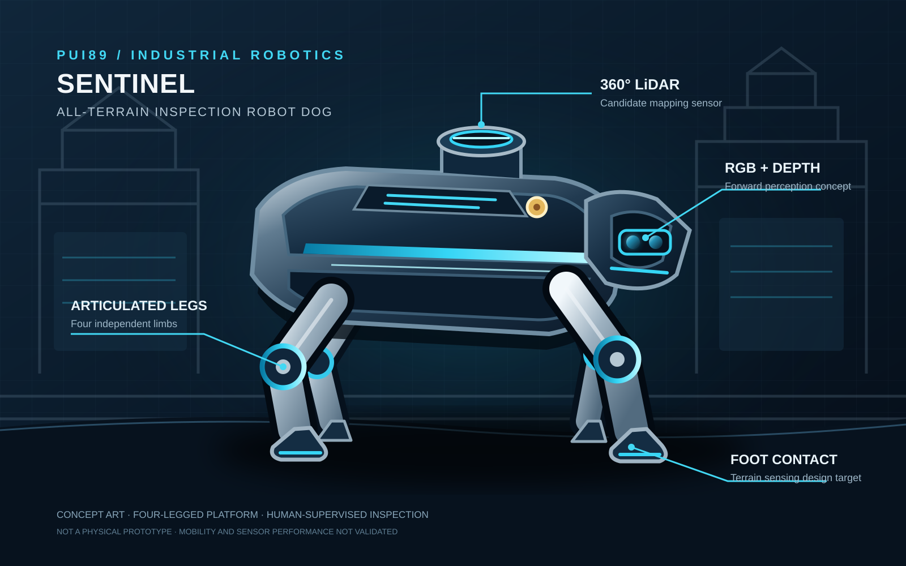
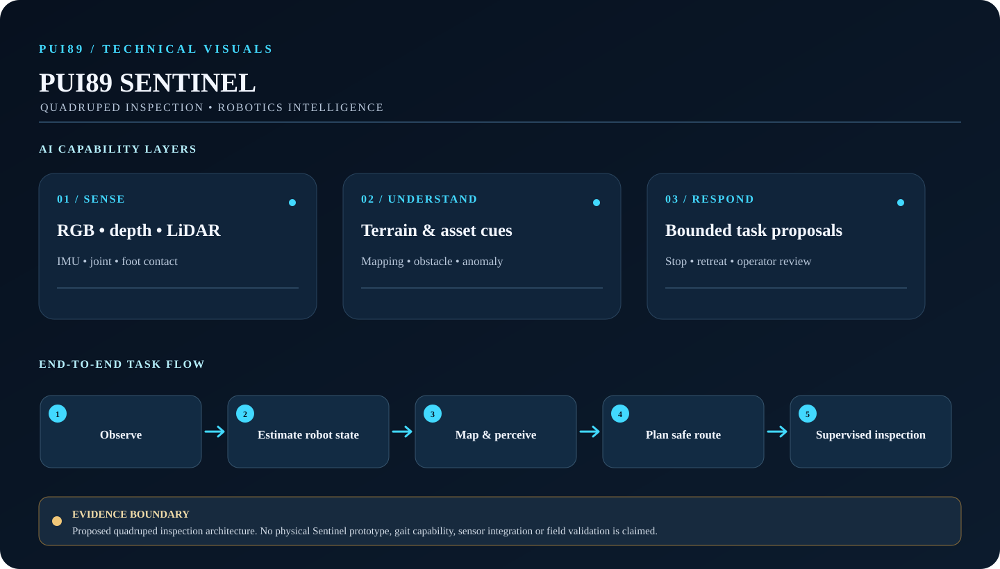

# PUI89 Sentinel — All-Terrain Exploration & Inspection Robot

## Product and AI system update — 18 November 2026

**Public product summary (EN):** PUI89 Sentinel is a four-legged, dog-shaped, ground-based exploration and inspection robot concept. It is intended for supervised reconnaissance in factories, industrial infrastructure, selected rough outdoor areas, disaster sites and difficult-access spaces after site clearance.

**เทคโนโลยีและประโยชน์ (TH):** หุ่นยนต์สี่ขาคล้ายสุนัขสำหรับสำรวจและตรวจสอบพื้นที่ที่คนเข้าถึงยากหรือมีความเสี่ยง ใช้กล้องและเซนเซอร์ที่เหมาะสมเพื่อสังเกตพื้นที่ ทำแผนที่ ประเมินพื้นผิว ตรวจจับสิ่งกีดขวาง/ความผิดปกติ และส่งข้อมูลให้เจ้าหน้าที่พิจารณา

**AI technology direction:** computer vision; optional depth and LiDAR; sensor fusion; SLAM and 3D mapping; IMU, joint-state and foot-contact estimation; terrain perception; quadruped gait/motion control; anomaly cues; edge processing; telemetry and operator alerts. Thermal or calibrated atmosphere instruments are mission-specific options, not assumed standard payloads.

**Who it serves:** industrial operators, infrastructure and facility teams, warehouses, inspection providers, researchers and authorised emergency-response organisations.

**Safety boundary:** “All-terrain” describes an engineering ambition, not guaranteed access. No physical prototype, integrated sensor suite, validated gait, field deployment or all-terrain performance is claimed. Hazardous-atmosphere entry cannot be approved by RGB/depth/LiDAR alone. AI outputs are observations or bounded proposals; human operators retain authority. Sentinel is not an enforcement or screening robot.

**Project website:** [English](https://pui89.github.io/sentinel.html) · [ภาษาไทย](https://pui89.github.io/sentinel-th.html) · [PUI89 portfolio](https://pui89.github.io/)

---

*Concept illustration only. It is not evidence of a built, tested or validated robot.*

## Product at a glance

**Product direction:** A supervised four-legged quadruped platform for exploration and inspection.

**User value:** Give authorised operators a way to observe and document difficult-to-access industrial, infrastructure, logistics and selected outdoor environments while keeping decisions under human supervision.

**Key capabilities and design priorities:** Quadruped mobility research; environment and terrain observation; sensor evidence capture; inspection reporting; operator-supervised task execution and safety boundaries.

**Evidence maturity:** **Specified** — product concept and engineering requirements are documented. The first supervised inspection mission and operating envelope remain to be selected; no physical prototype is established.

**Evidence reviewed:** 17 November 2026. See the [shared PUI89 development record](https://pui89.github.io/) for current evidence, limitations and the next milestone.

**Evidence boundary:** No physical prototype, integrated sensor suite, all-terrain performance or field deployment is claimed.

**Project links:** [English website](https://pui89.github.io/sentinel.html) · [PUI89 portfolio](https://pui89.github.io/)  

---
**Official project name:** PUI89 Sentinel — All-Terrain Exploration & Inspection Robot  
**Product identity:** Four-legged quadruped mobile inspection robot  
**Mission:** Supervised inspection, situational awareness and evidence capture in authorised industrial, infrastructure, logistics and selected outdoor environments.  
**Relationship to NOMAD:** Sentinel uses four articulated legs; PUI89 NOMAD is a separate four-wheel mobile assistant.  
**Development status:** Product concept and engineering requirements. No physical Sentinel prototype, field capability or sensor integration is claimed.

## Product direction

PUI89 Sentinel is a general-purpose **All-Terrain Exploration & Inspection Robot**: a four-legged quadruped for supervised inspection, situational awareness and traceable evidence capture. Its **General Multimodal Intelligence** combines authorised visual, audio, text, map, spatial and time-series sensor evidence with provenance, quality checks and uncertainty handling. This is general-purpose inspection intelligence—not a screening or enforcement product. Sentinel does not include narcotics detection, X-ray screening payloads or chemical-identification functions in its current product scope. The robot reports observations and bounded proposals for authorised human review.

### Target operating contexts

- Industrial facilities, plant rooms and infrastructure inspection.
- Warehouses, logistics yards, ports and authorised cargo areas.
- Selected container and confined-area inspection, subject to clearance, atmosphere and exit-route checks.
- Outdoor paths, paved surfaces, gravel, grass, soil, moderate slopes, steps and selected uneven terrain.
- Disaster-site reconnaissance from safe, authorised locations.
- Routine inspection patrols and documented condition monitoring.

These are target use cases, not validated deployments. Each site requires a risk assessment, operating permissions, environmental limits and task-specific verification.

## Mobility and physical design requirements

Sentinel is a four-legged robot with articulated legs, not a wheeled base. The mobility ambition is strong, agile and stable walking—not unrestricted movement everywhere.

- Controlled forward/reverse walking, turning, sidestepping and speed transitions.
- Terrain-aware gait selection and adaptive foot placement.
- IMU, joint-state and foot-contact estimation.
- Slip, stumble, obstacle and fall-risk detection.
- Managed centre of mass, payload envelope and power/thermal budget.
- Controlled stop, safe hold, supervised recovery and emergency-stop provisions.
- Local mapping and safe retreat planning where communications or GNSS are unavailable.

Candidate research methods include state estimation, gait planning, model-predictive control and whole-body control. These are candidate methods only, not selected or validated implementations.

**Terrain limits:** cliffs, deep water, unstable structures, hazardous atmospheres, inaccessible gaps, extreme slopes and any environment outside the validated operating envelope are no-go conditions. “All-terrain” is an engineering ambition, not a guarantee.

### Container and confined-area inspection

Before approaching or entering a container, the system must assess doorway width/height, threshold, body/leg clearance, floor condition, overhead and cargo hazards, localisation confidence and a viable exit route. It must support careful approach/alignment, controlled threshold step-over, low-light sensing, narrow-space navigation, mapping, turn/reverse/retreat and safe stop.

**Atmosphere safety:** RGB, depth and LiDAR do not certify breathable air or detect all hazardous gases. Entry requires site-authorised procedures and suitable calibrated atmosphere instruments where the risk assessment requires them. If clearance, footing, localisation, atmosphere status or exit route cannot be established, Sentinel must not enter or must stop and request operator assistance.

## Six Core Intelligence Groups

1. **Vision Intelligence** — scene understanding, object detection/classification, tracking, segmentation, depth and visual change/anomaly cues.
2. **Audio Intelligence** — speech interface, alarms, sirens and relevant acoustic events; no real-world speaker identity inference.
3. **Multimodal Intelligence** — context-aware combination of authorised image, audio, text, map and sensor/time-series evidence with provenance and uncertainty.
4. **Robotics Intelligence** — robot state, localisation, mapping, navigation, gait/motion planning and task-appropriate interaction.
5. **Action & Reaction Intelligence** — inspection task decomposition, bounded planning, event response, escalation, safe retreat and recovery proposals.
6. **Safety & Control Intelligence** — independent operating limits, permissions, verification, human approval, fault containment, safe hold and emergency-stop policy.

Safety policy is independent of model confidence. AI outputs are observations or bounded proposals, not direct authority to perform hazardous actions.

## Target sensor and compute architecture

| Capability | Candidate role | Status |
|---|---|---|
| RGB cameras | Visual inspection, scene context and evidence capture | Candidate |
| Depth camera | Near-field geometry and obstacle clearance | Candidate |
| 360° LiDAR | Mapping, localisation and obstacle awareness | Candidate |
| Thermal camera | Temperature-pattern observation where justified | Optional candidate |
| Microphones/speaker | Acoustic events and operator communication | Candidate |
| IMU + joint/foot sensors | Body state, gait and contact estimation | Required design function |
| Edge AI computer | Local perception, planning support and evidence handling | Candidate |
| Calibrated gas/atmosphere instruments | Specific atmosphere hazards when mission risk requires | Mission-specific; not included by default |

Exact manufacturers, part numbers, country of manufacture/origin, compatibility, supplier, dated price, lead time and warranty must be evidenced before procurement. No hardware has been selected or purchased through this specification.

## Safety, privacy and human oversight

- Operate only in authorised locations and within a documented operating envelope.
- Detect people and vehicles as dynamic obstacles; follow site traffic and exclusion rules.
- No autonomous enforcement, accusation, detention, search or coercive action.
- No biometric identity inference or voice identity recognition.
- Do not enter hazardous atmospheres or unstable structures based on camera/LiDAR interpretation alone.
- Stop safely on loss of localisation, unsafe footing, sensor disagreement, communications failure or unknown hazards.
- Preserve evidence provenance, timestamps, uncertainty, model/data version and operator review.
- Require human authorisation for consequential actions and site-specific procedures.

## Prototype cost — preliminary planning estimate

**Indicative allowance for one engineering prototype: ฿1,225,000–฿2,990,000.**

This is a high-uncertainty planning estimate for a custom four-legged platform, actuators and locomotion control, battery/power, core perception sensors, edge compute, integration and controlled testing. It is not a supplier quotation, verified BOM, fixed budget or evidence that a prototype exists.

Excludes engineering salaries, facilities, taxes/VAT, import duty, international freight, certification, production tooling, mass production and long-term maintenance. Thermal and specialist gas instruments may add cost depending on mission. Final cost requires a mass/payload definition, supplier-verified BOM and written quotations. No purchase is authorised.

## Development approach

1. Define mission scenarios, operating envelope and measurable acceptance criteria.
2. Build software workflows and simulation before hardware procurement.
3. Evaluate quadruped platform alternatives and non-Chinese-origin sourcing evidence.
4. Verify locomotion, stability, payload, endurance, thermal and environmental performance in controlled tests.
5. Conduct supervised site trials only after safety review and approvals.
6. Publish capability claims only when supported by reproducible evidence.

## Evidence and maturity boundary

Current status is **concept / requirements definition** for the physical robot. Software tools or simulated scenarios do not establish physical mobility, terrain capability, inspection accuracy or field readiness. No physical prototype, all-terrain performance, fall recovery, container entry, hazardous-atmosphere detection or industrial deployment is claimed.

## Architecture, validation and visual reference

- [Complete system blueprint](docs/COMPLETE_SYSTEM_BLUEPRINT.md)
- [Validation matrix](docs/VALIDATION_MATRIX.md)
- [Sentinel quadruped inspection concept v3](docs/images/pui89-sentinel-quadruped-inspection-v3.svg)

## Engineering requirements

- [All-Terrain Exploration & Inspection Robot engineering requirements v0.2](docs/SENTINEL_ALL_TERRAIN_INSPECTION_ROBOT_DOG_REQUIREMENTS_V0.2.md)

## Project links

- [English website](https://pui89.github.io/sentinel.html)
- [เว็บไซต์ภาษาไทย](https://pui89.github.io/sentinel-th.html)
- [PUI89 portfolio](https://pui89.github.io/)
- [Hardware & Materials Sourcing](https://pui89.github.io/materials.html)
- [PUI89 engineering standard](https://github.com/Pui89/Pui89.github.io/blob/main/docs/PUI89_SIMPLE_SAFE_PROFESSIONAL_STANDARD.md)

**PUI89 | Intelligent Systems. Verifiable Decisions. Safer Outcomes.**

## Operator Interaction Intelligence — PUI89 Sentinel

Sentinel uses the shared PUI89 interaction architecture for supervised operator communication:

- Receive spoken inspection instructions and support push-to-talk operator commands.
- Convert speech to text and provide concise spoken status, warning and task-completion reports.
- Explain a detected object, visible condition or sensor event by referring to the recorded evidence, timestamp, modality and uncertainty.
- Ask the operator to clarify ambiguous instructions and confirm consequential task changes.
- Support human review, correction, override and escalation.

**Sentinel-specific decision boundary:** interaction models may help communicate screening or inspection observations, but they must not independently identify a person, accuse someone of wrongdoing, declare a substance to be narcotics, or make a final screening or enforcement decision. All consequential findings require authorised human review and appropriate independent evidence.

**Recommended model candidates for Sentinel (not approved or integrated):**

| Model/tool | Role in Sentinel | Status |
|---|---|---|
| [openai/whisper-small](https://huggingface.co/openai/whisper-small) | Operator speech-to-text for push-to-talk inspection instructions; evaluate noisy field conditions | PENDING_REVIEW |
| [microsoft/Phi-4-mini-instruct](https://huggingface.co/microsoft/Phi-4-mini-instruct) | Optional operator dialogue, clarification and report phrasing; higher-resource candidate | PENDING_REVIEW |
| [hexgrad/Kokoro-82M](https://huggingface.co/hexgrad/Kokoro-82M) | English spoken status and warning reports; Thai TTS is not established | PENDING_REVIEW |
| [qualcomm/YamNet](https://huggingface.co/qualcomm/YamNet) | Selected environmental audio-event labels, subject to sensor and false-alarm testing | PENDING_REVIEW |
| [Silero VAD](https://github.com/snakers4/silero-vad) | Speech-segment detection for operator communication | PENDING_REVIEW |
| [HuggingFaceTB/SmolVLM2-500M-Video-Instruct](https://huggingface.co/HuggingFaceTB/SmolVLM2-500M-Video-Instruct) | Optional bounded visual descriptions to assist human review; never a screening verdict | PENDING_REVIEW |

No candidate may identify a person, determine that a substance is narcotics, accuse anyone, or issue a final screening/enforcement decision. Do not add openWakeWord's included pretrained weights at this stage because their CC BY-NC-SA 4.0 terms require separate review.

**Maturity:** proposed operator-interface configuration only. No interaction model, microphone, speaker or voice pipeline is claimed as installed, integrated or validated.

## World-Class Engineering Standard v1.0

This product follows the [PUI89 World-Class Engineering Standard v1.0](https://github.com/Pui89/Pui89.github.io/blob/main/docs/PUI89_WORLD_CLASS_ENGINEERING_STANDARD_V1.0.md), alongside the [PUI89 Simple, Safe & Professional Engineering Standard](https://github.com/Pui89/Pui89.github.io/blob/main/docs/PUI89_SIMPLE_SAFE_PROFESSIONAL_STANDARD.md). The shared standard defines requirements traceability, Shared AI Core contracts, PTI evaluation, simulation, safety, hardware provenance, cost engineering, verification and release gates. Product capabilities remain subject to their stated evidence and validation boundaries; this reference does not imply that a gate has been passed.

## PUI89 Technical Visual — AI workflow

*Proposed quadruped inspection architecture. No physical Sentinel prototype, gait capability, sensor integration or field validation is claimed.*

This diagram follows the [public PUI89 technical architecture overview](https://pui89.github.io/ai-core.html). It explains the proposed product-specific AI workflow and does not imply unverified implementation or physical capability.

## Portfolio consistency and founder-approved requirements

**PUI89 Sentinel — All-Terrain Exploration & Inspection Robot**

Founder-approved sequencing: define the first supervised inspection mission, target site/environment, operating envelope, hazards, human roles and measurable acceptance criteria before selecting hardware. Current physical status remains concept/requirements unless separate bench or field evidence is linked.

**ข้อกำหนดภาษาไทย**

ลำดับที่ผู้ก่อตั้งอนุมัติ: กำหนดภารกิจตรวจสอบแบบมีมนุษย์กำกับ พื้นที่และสภาพแวดล้อม ขอบเขตการทำงาน อันตราย บทบาทมนุษย์ และเกณฑ์ยอมรับที่วัดผลได้ ก่อนเลือกฮาร์ดแวร์ สถานะทางกายภาพยังเป็นแนวคิด/ข้อกำหนด เว้นแต่มีหลักฐาน bench หรือ field แยกต่างหาก

**Portfolio boundary:** PUI89 has exactly six active products. Shared AI Core is infrastructure, not a product. Extreme Flood Rescue AI is inactive as a standalone product; preserve historical records but do not present it as an active product.

## Everyday Intelligence, Simple Operation & On-Device Alerts

**Design principle:** AI for Everyone. Easy to Use. Safe to Trust. Ready for the Real World.

PUI89 Sentinel follows the PUI89 shared design direction: make everyday life easier through intelligence, not make people learn complicated technology.

- **Simple physical operation:** clear buttons and a safe, bounded start workflow. Basic local use should not require an app, smartphone pairing or internet where technically feasible. Voice is optional.
- **Multi-Perception Intelligence (MPI):** select mission-appropriate vision, audio, touch/contact, spatial, motion, thermal and environmental sensing. Chemical sensing or material analysis is only for specific validated instruments; these are not universal human-equivalent senses.
- **On-device text alerts:** a readable physical display is a mandatory design requirement. Show plain-language Information, Warning and Emergency messages, what happened, uncertainty and the next safe step. Keep local alert history. Optional mobile notifications supplement, never replace, device alerts.
- **Accessibility:** large readable text, clear controls, high contrast, optional audio, plain language and adjustable preferences.
- **Safety and reliability:** preserve human authority, independent emergency/protective stops, safe hold, fault reporting, uncertainty/abstention and controlled recovery. No silent restart into hazardous action.
- **Offline-first essentials:** local functions and alerts should continue without internet where technically possible and supported by the final hardware.

- **Animal awareness (where validated):** observe relevant pets and wildlife, maintain distance, avoid collisions, show uncertainty and alert a human. Never chase, touch, capture or disturb animals; species or venom identification is not claimed without dedicated validation.

**Shared specification:** [PUI89 Everyday Intelligence & Multi-Perception Standard v1.0](https://github.com/Pui89/PUI89-Shared-AI-Core/blob/main/docs/interaction/PUI89_EVERYDAY_INTELLIGENCE_MPI_STANDARD_V1.0.md). These are design requirements, not claims that displays, sensors, offline operation, animal recognition or physical functions are already implemented or validated.

## Local Access, Controls & On-Device Information

**No single point of access. No mandatory smartphone. No remote-only operation.**

The product must remain usable for its essential intended functions if a remote is lost, a phone is unavailable, an app is not installed, or internet/cloud connectivity is lost. The primary interface must fit the product; it does not have to be a button on the robot.

- Provide a clear **primary local control** integrated into the robot, operator station or installation, as appropriate.
- Provide an **independent fallback** that does not rely on the same remote, phone, app, wireless link or cloud service.
- Put essential status, instructions and warnings on a display or indicators physically associated with the product or its normal operator station.
- Remotes and mobile apps are optional convenience/secondary interfaces, never the only way to operate, receive critical alerts or safely stop the system.
- If control or communication is lost, enter a defined safe state and provide a documented local recovery path. Never bypass safety interlocks.
- Show concise plain-language information: Ready/Not ready, current task, what was detected and confidence, warning and next action, power/health, human-confirmation requests, and completion/fault history.
- Use Thai/English where implemented, large readable text, clear symbols and optional audio. Do not rely on sound or colour alone.

**Product-specific interface direction**
- Primary: on-robot physical controls and accessible local interaction. Fallback: local physical stop/control independent of phone or remote. Direct information: built-in display, lights and audio.
- Example: “Possible animal detected near the doorway. Please check from a safe distance. Identification not confirmed.”

These are design requirements and message examples, not claims that the display, controls, sensors or detection capability are already installed or validated.

**Shared standard:** [PUI89 Everyday Intelligence & Multi-Perception Standard v1.0](https://github.com/Pui89/PUI89-Shared-AI-Core/blob/main/docs/interaction/PUI89_EVERYDAY_INTELLIGENCE_MPI_STANDARD_V1.0.md).

## No App Required — End-to-End User Experience

**Customer-facing requirement:** PUI89 Sentinel must be usable from initial setup through everyday operation, monitoring, configuration, safe stopping and recovery without requiring the customer to download or install an application on a smartphone, tablet or computer. Essential functions must be available directly through the product or its appropriate local operator station.

- No mandatory smartphone application, application download, account registration or phone pairing for essential local operation.
- Essential local functions should work without internet access wherever technically feasible.
- Built-in controls and the appropriate local interface are primary. A remote or mobile app may be an optional convenience, never the sole means of control, critical alert access or recovery.
- Provide an independent local fallback, a safe state when control/communication is lost, and documented local recovery.
- Present operating state, warnings, recommended user actions and event history directly on the product or its normal operator station.
- Product-appropriate interface: on-robot controls plus a local mission/operator station.

**Engineering distinction:** Developers and authorized service personnel may use engineering tools for development, diagnostics and maintenance. These tools must not become prerequisites for ordinary customers.

**Evidence boundary:** This is a design requirement, not evidence that the controls, displays, offline behavior or hardware have been implemented, tested or certified.

### ไม่ต้องใช้แอป — ประสบการณ์ใช้งานตั้งแต่ต้นจนจบ

ลูกค้าต้องสามารถตั้งค่า ใช้งาน ตรวจสอบ ปรับการตั้งค่า หยุดอย่างปลอดภัย และกู้คืน PUI89 Sentinel ได้โดยไม่ต้องดาวน์โหลดหรือติดตั้งแอปบนสมาร์ตโฟน แท็บเล็ต หรือคอมพิวเตอร์ ฟังก์ชันที่จำเป็นต้องเข้าถึงได้โดยตรงจากตัวผลิตภัณฑ์หรือสถานีควบคุมในพื้นที่ที่เหมาะสม

- ไม่บังคับใช้แอปมือถือ ดาวน์โหลดแอป ลงทะเบียนบัญชี หรือจับคู่โทรศัพท์สำหรับการใช้งานพื้นฐาน
- ฟังก์ชันพื้นฐานภายในเครื่องควรทำงานได้โดยไม่พึ่งอินเทอร์เน็ตเมื่อเป็นไปได้ทางเทคนิค
- ระบบควบคุมที่ติดตั้งมากับผลิตภัณฑ์เป็นช่องทางหลัก รีโมตหรือแอปเป็นเพียงทางเลือกเสริม ไม่ใช่ช่องทางเดียวสำหรับควบคุม รับการแจ้งเตือนสำคัญ หรือกู้คืนระบบ
- ต้องมีช่องทางสำรองในพื้นที่ สถานะปลอดภัยเมื่อการควบคุมหรือการสื่อสารขัดข้อง และขั้นตอนกู้คืนที่ชัดเจน
- แสดงสถานะ คำเตือน การดำเนินการที่แนะนำ และประวัติเหตุการณ์บนผลิตภัณฑ์หรือสถานีปฏิบัติงาน

**ข้อแตกต่างด้านวิศวกรรม:** ทีมพัฒนาและเจ้าหน้าที่บริการที่ได้รับอนุญาตยังใช้เครื่องมือทางวิศวกรรมได้ แต่ลูกค้าทั่วไปไม่จำเป็นต้องใช้เครื่องมือเหล่านั้น

**ขอบเขตหลักฐาน:** เป็นข้อกำหนดด้านการออกแบบ ไม่ใช่หลักฐานว่าระบบควบคุม หน้าจอ การทำงานออฟไลน์ หรือฮาร์ดแวร์ได้รับการติดตั้ง ทดสอบ หรือรับรองแล้ว.

## On-Device Warning & Alert Experience

**Design requirement:** essential warnings and system status must be shown directly on the product's integrated display or appropriate local operator station. No smartphone app, account, pairing, internet connection or remote service may be required for critical alerts, safe stopping or essential recovery.

**Severity:** use four levels — **Information, Advisory, Warning and Emergency**. Each alert should state what happened, affected area/subsystem, time and source, confidence/uncertainty, recommended safe action, and whether human acknowledgement is needed. Missing, stale or conflicting evidence must not be presented as confirmed or safe.

**sentinel warning scope:** Mission and operator-control state; obstacle or route hazards; localisation or sensor-quality loss; restricted-area and environmental warnings; battery, thermal, actuator and communication faults.

**Product safety boundary:** The local operator station is the primary mission interface. Loss of command link, localisation or critical sensing must trigger a defined safe hold; no automatic mission resumption.

**Local resilience:** keep active alerts and timestamped history locally, including acknowledgement and cleared state. Support Thai and English where the interface supports both. Essential alerts should continue during internet/cloud loss where technically feasible; optional mobile notifications only mirror local alerts. Report sensor obstruction, stale data, communication loss and internal faults. Define a safe response; never silently continue or automatically restart hazardous operation. Provide local acknowledge, inspect, pause/stop and documented recovery paths. Never advise bypassing an interlock or protective stop.

### ภาษาไทย — การแจ้งเตือนบนตัวผลิตภัณฑ์

ต้องแสดงคำเตือนและสถานะสำคัญผ่านหน้าจอที่ติดตั้งกับผลิตภัณฑ์หรือสถานีควบคุมในพื้นที่ที่เหมาะสม ห้ามบังคับให้ใช้แอป บัญชีผู้ใช้ การจับคู่โทรศัพท์ อินเทอร์เน็ต หรือบริการระยะไกล เพื่อรับคำเตือนสำคัญ หยุดระบบอย่างปลอดภัย หรือกู้คืนการใช้งานพื้นฐาน

กำหนดระดับความรุนแรง 4 ระดับ ได้แก่ **ข้อมูล (Information), คำแนะนำ (Advisory), คำเตือน (Warning) และฉุกเฉิน (Emergency)** แต่ละข้อความควรระบุเหตุการณ์ ระบบที่เกี่ยวข้อง เวลาและแหล่งข้อมูล ความเชื่อมั่น/ความไม่แน่นอน การดำเนินการที่ปลอดภัย และการยืนยันจากมนุษย์เมื่อจำเป็น ห้ามแสดงข้อมูลที่ขาดหาย ล้าสมัย หรือขัดแย้งกันว่าเป็นข้อเท็จจริงหรือปลอดภัย

**ขอบเขตคำเตือนเฉพาะผลิตภัณฑ์:** สถานะภารกิจและการควบคุม สิ่งกีดขวางหรืออันตรายตามเส้นทาง การสูญเสียตำแหน่งหรือคุณภาพเซนเซอร์ คำเตือนพื้นที่จำกัด แบตเตอรี่ อุณหภูมิ ชุดขับเคลื่อน และการสื่อสาร

**ขอบเขตความปลอดภัย:** สถานีควบคุมในพื้นที่เป็นส่วนติดต่อหลัก เมื่อสูญเสียการสื่อสารควบคุม การระบุตำแหน่ง หรือเซนเซอร์สำคัญ ต้องเข้าสู่สถานะหยุดอย่างปลอดภัยและห้ามเริ่มภารกิจต่อโดยอัตโนมัติ

เก็บคำเตือนที่ยังทำงานและประวัติเหตุการณ์พร้อมเวลาไว้ในระบบภายใน รองรับภาษาไทยและอังกฤษตามความสามารถของส่วนติดต่อ คำเตือนสำคัญควรทำงานได้เมื่ออินเทอร์เน็ตหรือคลาวด์ขัดข้องเท่าที่เทคโนโลยีรองรับ การแจ้งเตือนผ่านมือถือเป็นเพียงช่องทางเสริม ต้องรายงานเซนเซอร์ถูกบัง ข้อมูลล้าสมัย การสื่อสารขาดหาย และความขัดข้อง พร้อมกำหนดการตอบสนองที่ปลอดภัยและห้ามเริ่มการทำงานเสี่ยงต่อโดยอัตโนมัติ ผู้ใช้ต้องรับทราบ ตรวจสอบ หยุดหรือพักระบบ และกู้คืนจากส่วนควบคุมในพื้นที่ได้ ห้ามแนะนำให้ข้ามระบบป้องกัน

**Evidence status:** design requirement only; no display, alert hardware, offline behaviour or safety performance is claimed as implemented or validated. Conformance remains **Unknown / Not Tested** until traceable evidence exists.

## Incident Evidence, Image Recall & User-Requested Review

When an abnormal condition is detected, create a traceable incident record locally. Where a suitable camera or image sensor is actually available, save relevant captured image(s) on protected product storage. Never imply an image exists if none was captured; link original evidence to its incident.

Each record should include, where available: unique incident ID; local date/time and time zone; product/subsystem and location or zone; severity; event title and plain-language summary; full alert text and spoken message; source sensor; confidence/uncertainty and data-quality state; captured image(s); and acknowledgement, review and resolution history. Clearly mark missing images, unavailable sensors, uncertain timestamps and incomplete records.

**User-controlled history:** provide a local **READ / VIEW HISTORY** control on the product display or appropriate console. Browse year → month → day; open summaries; press to read full alerts; view saved images; replay spoken alerts where supported; and navigate earlier/later incidents. Show event date/time and incident ID beside every image. Filters by severity, subsystem and unresolved/resolved state are desirable.

**Local preservation:** history must be reviewable without a phone, app, cloud or internet. Warn when storage is nearing capacity. Never silently overwrite or automatically delete important incident evidence. Define a visible retention/capacity policy and user-controlled export/recovery before implementation. Protect records against accidental alteration and restrict access appropriately; do not claim tamper-proof storage unless verified.

**Product-specific evidence scope:** Terrain/route observations, obstacles, environmental anomalies, localisation/sensor faults, mission-state changes and operator interventions. Records help reconstruct what the robot observed and why it entered safe hold.

**Evidence status:** design requirement only. Image capture, local storage, date-based search, voice replay, preservation, privacy controls and recovery remain **Unknown / Not Tested** until verified on the actual product.

### ภาษาไทย — หลักฐานเหตุการณ์และภาพย้อนหลัง

เมื่อระบบตรวจพบความผิดปกติ ให้สร้างบันทึกเหตุการณ์ไว้ภายในผลิตภัณฑ์ หากมีกล้องหรือเซนเซอร์ภาพที่เหมาะสมและใช้งานได้จริง ให้บันทึกภาพที่เกี่ยวข้องไว้ในพื้นที่จัดเก็บภายใน ห้ามกล่าวอ้างว่ามีภาพหลักฐานหากไม่มีการบันทึกจริง และต้องเชื่อมโยงภาพต้นฉบับกับเหตุการณ์นั้น

ข้อมูลควรมีเท่าที่ระบบบันทึกได้: รหัสเหตุการณ์; วันที่และเวลาพร้อมเขตเวลา; ผลิตภัณฑ์/ระบบย่อยและตำแหน่ง; ระดับความรุนแรง; หัวข้อและสรุปที่เข้าใจง่าย; ข้อความแจ้งเตือนฉบับเต็มและข้อความเสียง; เซนเซอร์ต้นทาง; ความไม่แน่นอนและคุณภาพข้อมูล; ภาพที่บันทึก; ประวัติการรับทราบ ตรวจสอบ และแก้ไข หากไม่มีภาพ เซนเซอร์ไม่พร้อม เวลาไม่แน่นอน หรือข้อมูลไม่ครบ ต้องแสดงให้ชัดเจน

**ผู้ใช้เรียกดูเองได้:** มีคำสั่ง **READ / VIEW HISTORY** บนหน้าจอผลิตภัณฑ์หรือคอนโซลในพื้นที่ เลือกดู ปี → เดือน → วัน เปิดสรุป กดอ่านข้อความฉบับเต็ม ดูภาพ เล่นเสียงแจ้งเตือนซ้ำเมื่อรองรับ และเลื่อนไปยังเหตุการณ์ก่อนหน้าหรือถัดไป ทุกภาพต้องแสดงวันที่ เวลา และรหัสเหตุการณ์ ควรกรองตามระดับความรุนแรง ระบบย่อย และสถานะเหตุการณ์ได้

**การเก็บรักษาภายใน:** ต้องเรียกดูประวัติได้โดยไม่ใช้โทรศัพท์ แอป คลาวด์ หรืออินเทอร์เน็ต แจ้งเตือนเมื่อพื้นที่ใกล้เต็ม ห้ามเขียนทับหรือลบหลักฐานสำคัญโดยอัตโนมัติ ต้องกำหนดนโยบายพื้นที่/ระยะเวลาเก็บรักษาที่ผู้ใช้มองเห็นได้ และการส่งออก/กู้คืนที่ผู้ใช้ควบคุมได้ ป้องกันการแก้ไขโดยไม่ตั้งใจและจำกัดสิทธิ์อย่างเหมาะสม ห้ามกล่าวอ้างว่าป้องกันการแก้ไขได้สมบูรณ์หากยังไม่ผ่านการตรวจสอบ

**ขอบเขตหลักฐานเฉพาะผลิตภัณฑ์:** Terrain/route observations, obstacles, environmental anomalies, localisation/sensor faults, mission-state changes and operator interventions. Records help reconstruct what the robot observed and why it entered safe hold.

**สถานะหลักฐาน:** ข้อกำหนดการออกแบบเท่านั้น การบันทึกภาพ การจัดเก็บ การค้นหาตามวัน/เดือน การเล่นเสียงย้อนหลัง การรักษาหลักฐาน ความเป็นส่วนตัว และการกู้คืนยังเป็น **Unknown / Not Tested** จนกว่าจะพัฒนาและทดสอบกับผลิตภัณฑ์จริง

---

## Easy to Build. Easy to Repair. Built to Grow.

PUI89's engineering principle for this product is to start with the simplest useful configuration, make modules understandable and serviceable, and allow verified capabilities to grow without redesigning the entire system.

- **Easy to Build:** prefer simple, documented and available components; separate essential functions from optional upgrades.
- **Easy to Repair:** use accessible replaceable modules, labelled connections, diagnostics and documented service/recovery procedures.
- **Built to Grow:** use versioned interfaces and adapters so compatible sensors, compute and software modules can be added without breaking verified functions.
- **Graceful degradation:** identify missing, stale or failed modules, explain the lost capability and enter the product-specific safe state when a critical function is affected.
- **Product-specific engineering:** reuse shared software and proven interfaces where appropriate, but do not force identical hardware, mechanics, power or safety designs across different products.

**Shared design standard:** [PUI89 Build, Repair & Grow Design Principle v1.0](https://github.com/Pui89/Pui89.github.io/blob/main/docs/PUI89_BUILD_REPAIR_GROW_DESIGN_PRINCIPLE_V1.0.md). This is a design requirement, not a claim that modular hardware, repair procedures or product capabilities have already been implemented or validated.

### ภาษาไทย

**สร้างง่าย ซ่อมง่าย และต่อยอดได้** — เริ่มจากระบบที่เล็กที่สุดซึ่งพิสูจน์ประโยชน์ได้จริง ใช้โมดูลที่เข้าใจและเปลี่ยนได้ง่าย มีจุดเชื่อมต่อและขั้นตอนซ่อมบำรุงชัดเจน และเพิ่มความสามารถโดยไม่ต้องออกแบบระบบทั้งหมดใหม่ ต้องแจ้งเมื่ออุปกรณ์ขาดหายหรือขัดข้อง และเข้าสู่สถานะปลอดภัยเฉพาะผลิตภัณฑ์เมื่อกระทบฟังก์ชันสำคัญ สามารถใช้ซอฟต์แวร์หรือส่วนเชื่อมต่อร่วมกันได้เมื่อผ่านการตรวจสอบ แต่ไม่บังคับให้ทุกผลิตภัณฑ์ใช้ฮาร์ดแวร์ กลไก พลังงาน หรือระบบความปลอดภัยแบบเดียวกัน

**มาตรฐานกลาง:** [PUI89 Build, Repair & Grow Design Principle v1.0](https://github.com/Pui89/Pui89.github.io/blob/main/docs/PUI89_BUILD_REPAIR_GROW_DESIGN_PRINCIPLE_V1.0.md). เป็นข้อกำหนดการออกแบบ ไม่ใช่การยืนยันว่าฮาร์ดแวร์แบบโมดูล ขั้นตอนซ่อม หรือความสามารถของผลิตภัณฑ์ได้พัฒนาและตรวจสอบแล้ว

## PUI89 Product Operating Coverage Standard

Follow the [PUI89 Product Operating Coverage Standard v1.0](https://github.com/Pui89/Pui89.github.io/blob/main/docs/PUI89_PRODUCT_OPERATING_COVERAGE_STANDARD_V1.0.md) for per-unit allocation, appropriate coverage measurements, evidence labels, validation records and public-claim controls. This is a proposed shared requirement, not proof of physical performance. Do not publish numerical area, throughput, range, runtime, accuracy or productivity claims without product-specific test evidence. Product-specific requirements and safety boundaries in this repository remain controlling.
