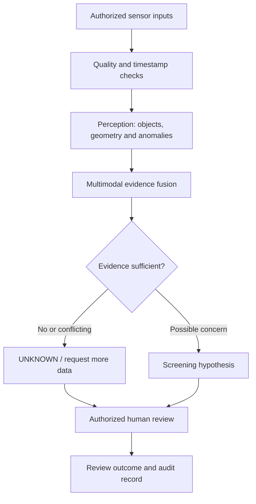
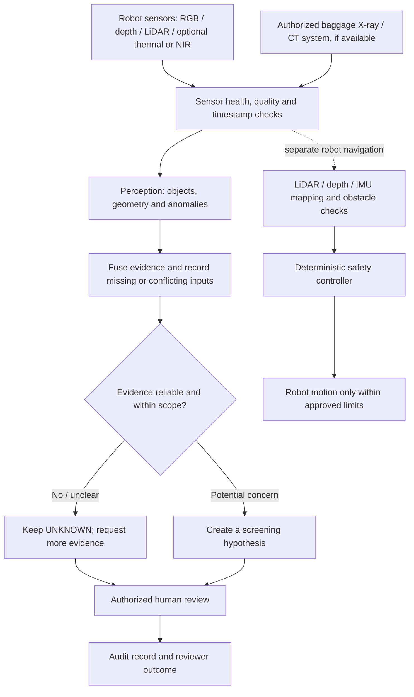

# Multimodal Narcotics Screening AI Application

## Free local Hugging Face model plan

This repository's recommended local model, intended tasks, licence checks, setup notes, and no-surprise-billing rules are documented in **[HUGGINGFACE_LOCAL_MODELS.md](docs/HUGGINGFACE_LOCAL_MODELS.md)**.

**Cost boundary:** the plan uses downloaded local weights only; it does not require paid Hugging Face inference, cloud GPUs, paid notebooks, or a subscription. Model integration and performance must be verified by running tests locally.

**Free dataset and labelling workflow:** see [dataset sources, licence checks, annotation and training plan](docs/DATASET_ACQUISITION_AND_LABELING.md), the [manifest template](data/manifest.template.csv), and the [local manifest audit tool](tools/audit_dataset_manifest.py). No images are automatically considered licensed or correctly labelled; the manifest must be completed and audited locally before training.


[Detailed project status, checks, next steps and future plan](docs/PROJECT_STATUS_2026-10-18.md)

## Project status overview — updated 18 October 2026

**Current stage: screening workflow prototype and evaluation-pipeline testing. Not a validated narcotics detector.**

| Status | What it means today |
|---|---|
| **Successful** | The latest GitHub Actions regression run passed on Python 3.10, 3.11 and 3.12. The evaluation runner validates records and confidence values; metric tests cover invalid inputs and calibration safeguards. |
| **In progress** | Making evaluation repeatable and documenting the data, annotation, and reporting requirements. |
| **Synthetic-only evidence** | The checked-in JSONL and report verify that the evaluation pipeline runs. They are not narcotics data, trained-model predictions, or real screening-performance results. |
| **Not yet demonstrated** | A trained detector validated on an independent, representative, lawfully obtained dataset; reliable chemical identification; deployment-ready multimodal fusion; or a validated physical screening robot. |
| **Next** | (1) Define a lawful, narrowly scoped intended use; (2) obtain appropriately authorized/licensed data; (3) document labels and independent splits; (4) evaluate a baseline and report per-class precision/recall, confusion matrix, false-positive/false-negative rates, abstention and calibration; (5) perform privacy, bias, security and human-review testing. |
| **Future** | Compare modalities only where real sensor data and lawful access exist; test distribution shifts and sensor failures; conduct independent expert review and controlled pilot evaluation before any operational claim. |

**Evidence boundary:** successful CI proves that the automated software checks passed—not that narcotics can be identified accurately. The application must present uncertain results as uncertain, require authorized human review, and never treat an AI score as proof of a substance's identity. See the [validation and commercial roadmap](docs/VALIDATION_AND_COMMERCIAL_ROADMAP.md), [evaluation guide](evaluation/README.md), and [GitHub Actions](https://github.com/Pui89/Multimodal-Narcotics-Screening-AI/actions).

---

## New Robot Concept Image


Original project artwork showing a mobile inspection robot with RGB/depth/LiDAR sensors, luggage observation, a separate authorized X-ray/CT station, and an operator review console. **This is concept illustration—not a real photograph, deployed robot, chemical identification, or validated detector.** The system must preserve `UNKNOWN` when evidence is insufficient and require authorized human review.

## AI Application Overview

## How the AI application works

The AI application is the software layer that receives authorized sensor observations, checks data quality, combines supported evidence, reports uncertainty, and helps an authorized person review a case. The application can be tested on a computer with recorded or simulated data; connecting a physical robot is a separate integration step.

### Application workflow



1. **Input:** use only sensor data the project actually supports and that is authorized for the intended purpose. RGB, depth, thermal/NIR and LiDAR are possible modalities when appropriate hardware is connected. Authorized X-ray/CT baggage images are a separate input source when available.
2. **Quality gate:** check sensor health, image quality, timestamps, calibration and missing modalities.
3. **AI perception:** analyze supported visual features, object geometry or anomalies; do not infer facts that the sensors cannot observe.
4. **Evidence fusion:** compare available modalities and record agreement, contradictions and missing data.
5. **Uncertainty:** preserve `UNKNOWN` when evidence is insufficient or out of scope. A visual match is a screening hypothesis, not proof of chemical identity.
6. **Human review:** an authorized reviewer makes the consequential decision and the application records the review outcome.
7. **Evaluation:** test with documented, lawfully usable datasets and report false positives, missed cases, calibration and limitations before considering any field trial.

### Concept image and real-image reference


*Concept dashboard showing a proposed review interface. It is illustrative artwork, not a live application screenshot or proof of detector performance.*


*Real reference photograph from Wikimedia Commons: [Samples of drugs](https://commons.wikimedia.org/wiki/File:Samples_of_drugs.jpg), licensed CC0 1.0 according to its source page. It is used for documentation only, not as a validated training/evaluation dataset or evidence of any particular case.*

**Important limits:** ordinary RGB photos cannot reveal drugs hidden inside closed luggage, and a photo of a substance cannot reliably determine its chemical identity. Baggage screening requires a suitable authorized X-ray/CT system and data; chemical identity requires an authorized validated test or forensic procedure. This repository is a research prototype, not a validated airport detector.

## Free reproducible testing and evaluation

The repository includes API regression tests, evaluation-metric tests, a clearly labelled synthetic JSONL example, and a GitHub Actions workflow that runs on relevant pushes and pull requests. These checks use free/open-source Python tooling; hosted CI availability and quotas are controlled by GitHub.

- [Regression tests](apps/pui89_app/test_main.py)
- [Evaluation metrics tests](evaluation/test_metrics.py)
- [Synthetic example and evaluation guide](evaluation/README.md)
- [Automated regression workflow](.github/workflows/app-regression.yml)

Run locally from the repository root:

```bash
python -m pip install "fastapi>=0.110,<1.0" "pydantic>=2.6,<3.0"
python -m unittest apps.pui89_app.test_main evaluation.test_metrics -v
python evaluation/run_evaluation.py evaluation/examples/synthetic_predictions.jsonl --output reports/synthetic-evaluation.json
```

The sample results are synthetic teaching data, not narcotics-detection performance. The API still uses manually entered feature values and heuristic rules, not a trained image detector.

## Interactive AI application example

A local Streamlit dashboard is available to demonstrate the evidence-review workflow using manually entered sample values. You can toggle RGB/depth/thermal/LiDAR status, adjust timestamp alignment and illustrative anomaly/consistency scores, inspect `UNKNOWN` and human-review outcomes, and export a JSON report.

**Run from the repository root.** Install dependencies:

```bash
python -m pip install -r apps/pui89_app/requirements.txt
```

Terminal 1:
```bash
uvicorn apps.pui89_app.main:app --reload
```

Terminal 2:
```bash
streamlit run apps/pui89_app/web_demo.py
```

- [Dashboard source code](apps/pui89_app/web_demo.py)
- [Application setup and API guide](apps/pui89_app/README.md)
- [Interactive API documentation](http://127.0.0.1:8000/docs) after the API starts

**Important:** this is a local prototype, not a hosted public demo. Uploaded images are preview-only; no trained vision model analyzes them. The output uses manually entered example features and heuristic rules. It cannot identify chemical substances, prove narcotics are present, authorize enforcement, or control a robot. Use validated procedures and authorized human review.

## How the AI robot works

This section explains the proposed robot workflow using the concept illustrations and real, openly licensed reference photographs already linked in this README. The concept visuals show a design idea; they are not photographs of a deployed robot or evidence of validated narcotics-detection performance.

### Robot workflow at a glance



### What happens at each stage?

1. **Sense:** cameras and other configured sensors observe accessible objects and the surrounding environment. The robot may carry sensors, but each modality must actually be installed and integrated before it can be used.
2. **Check sensor quality:** the software checks whether observations are usable, synchronized and correctly attributed. Missing or degraded inputs are recorded rather than silently treated as evidence.
3. **Analyze:** computer-vision models can describe supported visual features, object geometry or anomalies. The application combines available signals and records disagreement.
4. **Express uncertainty:** if evidence is insufficient or unfamiliar, the system returns `UNKNOWN` or requests more data. A visual pattern is not chemical proof.
5. **Ask for human review:** an authorized officer evaluates the screening hypothesis and decides what, if anything, should happen next. The AI must not independently accuse, search, detain or make enforcement decisions.
6. **Move safely:** robot navigation is a separate control path using configured mapping and obstacle sensors plus deterministic safety controls. A foundation model or screening result must not directly command motors.
7. **Keep an audit trail:** record sensor provenance, model/software version, uncertainty, and the human review outcome according to the applicable privacy and evidence rules.

**Important limitation:** ordinary RGB photographs cannot reveal drugs hidden inside closed luggage, and a photo of a substance cannot reliably establish its chemical identity. Baggage X-ray/CT screening requires an appropriate authorized system and legally usable data. Chemical identity requires an authorized, validated test or forensic procedure.

### Concept visuals and real reference photos

- The [animated robot/application concept](docs/images/multimodal-screening-ai-demo.svg), [dashboard concept](docs/images/multimodal-ai-application-dashboard.svg), and [3D/4D robot concept](docs/multimodal_narcotics_screening_robot_3d_4d_concept.svg) illustrate a proposed interface and system design, not real-time operation.
- The real reference photos linked below have their own source and licence notes. They are included for visual context only, not as a validated training dataset, and must not be presented as photographs from a specific Thai arrest unless the original source confirms that provenance.
- For Thai airport case context, this README links to official government/customs reports instead of rehosting photos where open reuse permission is not clear.

### Open-licensed reference photograph: narcotics screening


**Image and cost note:** The remaining reference photograph is hosted by Wikimedia Commons and its source page identifies it as CC0/public domain, so no paid image subscription is required to reuse it under those stated terms. External hosting availability is not guaranteed. Do not use this reference photo as labelled training or evaluation data without checking dataset suitability and provenance.

### Thailand narcotics arrest and seizure reference (official source)

For a **real Thai law-enforcement context**, see the [Royal Thai Government photo gallery for the major narcotics-trafficking arrest announcement on 12 May 2026](https://www.thaigov.go.th/th/media/gallery/view/29367). Also see the [Thai Government / Customs report on 2026 drug seizures](https://www.thaigov.go.th/th/news/165914), which reports that methamphetamine (“ice”) and heroin were among the leading substances seized in the first nine months of fiscal year 2026.

**Copyright and evidence note:** These are official Thai case-report links, not open-licensed image files. I have linked to the original government pages rather than copying those photos into this repository because the pages do not clearly grant an open reuse licence. The Wikimedia Commons photos below are separate, openly licensed specimen/plant references; **they are not photographs of the Thai arrests or seizures**. This distinction avoids falsely presenting generic reference images as evidence from a particular case.

### Free, open-licensed reference images: ice, heroin and cannabis

These real photographs are included as **visual reference examples** for a research interface and documentation. They are not a labelled dataset, do not prove chemical identity, and must not be described as model-training or evaluation evidence.

#### Crystal methamphetamine (“ice”)


*Photo: WikiLinuz, [Crystal methamphetamine (2).jpg](https://commons.wikimedia.org/wiki/File:Crystal_methamphetamine_(2).jpg), released under [CC0 1.0](https://creativecommons.org/publicdomain/zero/1.0/). The licence permits reuse without attribution, though attribution is provided here for provenance.*

#### Heroin


*Photo: DMTrott, [Heroin (Drug).jpg](https://commons.wikimedia.org/wiki/File:Heroin_(Drug).jpg), licensed under [CC BY-SA 4.0](https://creativecommons.org/licenses/by-sa/4.0/). Credit the author, link the licence, note any changes, and share adaptations under the same or a compatible licence.*

#### Real airport cannabis-seizure photograph


*Photo credit: Thai Customs Department/Facebook, published by [The Straits Times in its report on a Phuket airport cannabis seizure](https://www.straitstimes.com/asia/se-asia/russian-man-arrested-with-17-6kg-of-cannabis-at-phuket-airport). The report says customs officers found vacuum-sealed packs of cannabis flowers and cannabis resin in suitcases at Phuket International Airport in July 2026. This is a real seizure-reference image, not an open-licensed image; it is linked from the publisher's image host for project documentation. Please check permission before redistributing or republishing the image elsewhere. It is not a labelled training dataset or proof of AI detection performance.

*Photo: Scrinterlocked, [Dried Cannabis Flowers.jpg](https://commons.wikimedia.org/wiki/File:Dried_Cannabis_Flowers.jpg), licensed under [Creative Commons Attribution-ShareAlike 3.0 (CC BY-SA 3.0)](https://creativecommons.org/licenses/by-sa/3.0/). This is a real reference photograph of dried cannabis flowers, not a photograph of a Thai arrest or seizure. It is included for visual documentation only—not as a labelled training dataset, proof of chemical identity, or evidence of AI detection performance.*


## Airport Terminal Crowd Monitoring: Moving Robot, People Flow, and Operator Screen

This proposed extension focuses on a busy terminal where many passengers walk in different directions. The robot's useful role would be to **support routine patrol and show aggregate crowd-flow information to staff**—not to identify or rank individual passengers. The illustration below is an original concept, not a photograph of a real Pui89 robot or a live system.


### What the terminal screen could show

A local operator dashboard could display:
- **People count by zone** and approximate flow direction, using a camera or depth sensor that the airport has authorized for this purpose.
- **Crowd-density / queue alerts** when an aggregate count exceeds a site-configured threshold.
- **Robot status**: current patrol zone, obstacle/sensor health, battery, and whether remote assistance is needed.
- **Review queue**: time-stamped events for a trained operator to verify before taking action.

**Privacy by design:** the proposed screen should show aggregate counts, zone heatmaps and flow arrows—not facial recognition, identity matching, emotion inference, or automatic suspicious-person scores. Any real camera processing would need airport authorization, privacy/security review, access controls, and a documented retention policy. If possible, process video locally and store only the minimum event metadata required.

### How it could reduce routine worker workload

1. The robot follows an approved route and uses obstacle sensing to move among walking passengers; in crowded or uncertain situations it slows, stops, or requests remote assistance.
2. A connected, authorized sensor produces aggregate counts and flow estimates for defined terminal zones.
3. The screen alerts staff to congestion, blocked walkways, or a sensor/robot fault.
4. Staff use the alert to decide whether to redirect a queue, make an announcement, or dispatch help.

This can reduce repetitive walking and manual observation, but it **does not safely replace airport police, security, customs, or terminal staff**. People are unpredictable; human staff remain responsible for context, emergencies, accessibility needs and consequential decisions.

### Implementation status — be precise

**Implemented now:** the repository's local screening dashboard prototype, manual example-feature inputs, heuristic rules, regression tests and synthetic evaluation examples described above.

**Concept only / not implemented yet:** autonomous terminal navigation, live camera or depth-sensor input, real-time crowd counting/tracking, a live crowd-monitoring screen, connection to airport CCTV, and a physical robot. The illustration's count (“42”) is an example label, not a measured result. The external videos show other organizations' robots, not this project.

**Suggested free local next step:** create a simulation-only corridor/terminal scene with moving pedestrian agents, a robot route, obstacle stops and a dashboard fed by simulated counts. Label every output as simulated. Only after that should authorized, privacy-reviewed recorded video be evaluated offline; do not test on public CCTV or deploy in a real terminal without explicit authorization.


---

## Validation status, labelling, training and measured results

**Evidence status:** this repository has a local review-oriented API/dashboard, metric utilities and a synthetic JSONL evaluation example. The dashboard uses manually entered example features; uploaded images are preview-only and no trained vision model analyses them. The synthetic example tests evaluation plumbing, not narcotics-screening performance. No validated chemical identification, baggage X-ray/CT detector or deployed screening robot is established here.

| Workstream | Current evidence | Status / next step |
|---|---|---|
| Application/API | Local review dashboard with illustrative rules | Prototype; run a clean-install smoke test |
| Evaluation code | Classification and calibration metrics plus JSONL runner | Utility code; test with genuine model predictions |
| Labelled data | No verified task-specific benchmark established here | Secure lawful data access and expert-reviewed labels |
| Training | No verified trained checkpoint established here | Define one bounded modality/task and train a licensed baseline |
| Real-data evaluation | No real held-out metrics established here | Report per-class errors, calibration, abstention and latency |
| Robotics | Concept architecture and separate navigation/safety design | Physical integration and safety not validated |
| Commercial readiness | Research/feasibility prototype | Not ready to sell as a validated detector |

### Data and labelling protocol

1. Define the task and modality. Ordinary RGB photos cannot reveal contents inside closed baggage or reliably establish chemical identity. Baggage screening requires appropriate authorized X-ray/CT equipment and legally usable data; chemical identity requires an authorized validated analytical procedure.
2. Use only lawfully usable data. Record source, permission/licence, modality, acquisition conditions, dataset version and annotation protocol. Apply privacy, access-control and retention requirements to sensitive data.
3. Label only what the evidence supports. Use an approved review/clear/unknown protocol where appropriate; record ambiguous cases and expert adjudication. Never label chemical identity from appearance alone.
4. Split by item, session, site or source to prevent near-duplicate leakage. Freeze the final test split.
5. Train a local baseline and record commit, dataset checksum, split counts, annotation version, seed, configuration, hardware, package versions, elapsed time and checkpoint checksum.
6. Generate genuine model predictions on the frozen test set and evaluate with the existing JSONL runner. Each row must contain adjudicated y_true, actual model y_pred and meaningful confidence from 0 to 1.
7. Report per-class precision/recall/F1, confusion matrix, false-positive/false-negative counts, calibration, abstention or UNKNOWN coverage, robustness by acquisition condition, latency, hardware and failure analysis.
8. Keep screening separate from enforcement and robot motion. Model output is a review hypothesis, never proof of a substance or grounds for autonomous enforcement. Require authorized human review and a separate deterministic robot safety controller.

Example command: python evaluation/run_evaluation.py path/to/real_test_predictions.jsonl --output reports/real-test-v1.json

### Honest results and release gate

No real-dataset performance metrics are claimed by this documentation update. The checked-in synthetic example must not be cited as real model performance. Publish results only with dataset provenance, annotation/adjudication policy, frozen split counts, model/checkpoint checksum, exact reproduction command and error analysis.

**Buyer position:** suitable now for research collaboration, evaluation tooling and feasibility studies with an authorized data partner. Do not market it as a validated narcotics detector or autonomous enforcement robot. Commercial release requires intended-use definition, legal/regulatory review, independent validation, privacy/security controls, authorized human review, auditability and customer-agreed acceptance criteria.

See the [validation and commercial roadmap](docs/VALIDATION_AND_COMMERCIAL_ROADMAP.md).


## Automated evaluation safeguards

The automated regression workflow runs API safety tests, metric tests, evaluation-runner input-validation tests, and a synthetic-report smoke check on pushes and pull requests affecting the application or evaluation code. The runner validates labels and confidence, rejects contradictory correctness flags, and treats `review` as the default positive class when present. See [evaluation instructions](evaluation/README.md) and the [workflow](.github/workflows/app-regression.yml).

The synthetic report is only a pipeline check. No real-data screening benchmark or trained image detector is claimed by these tests.
