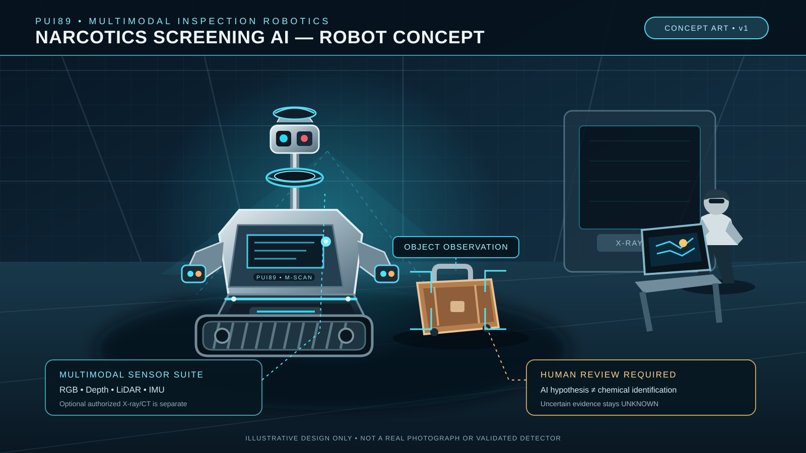
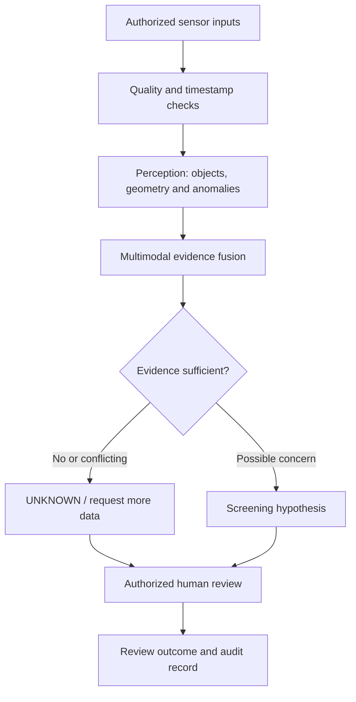
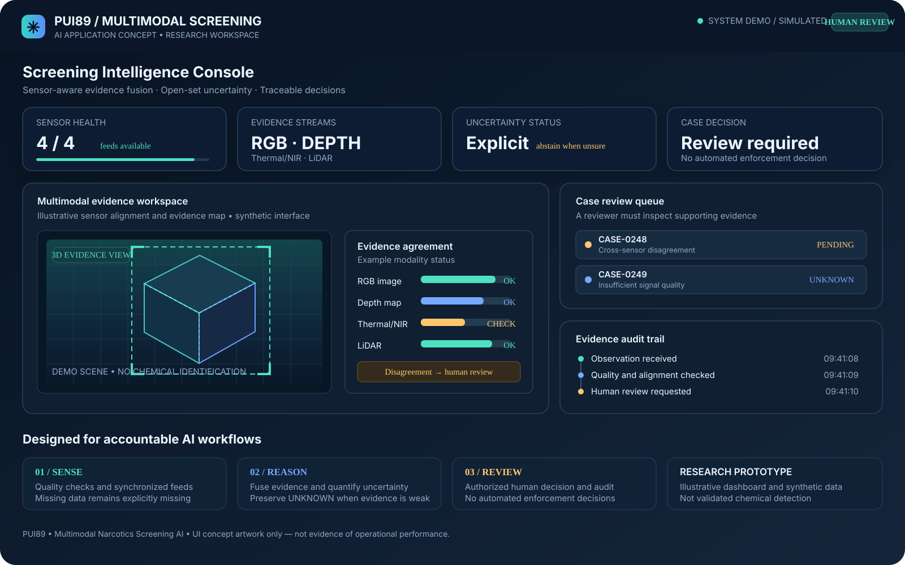
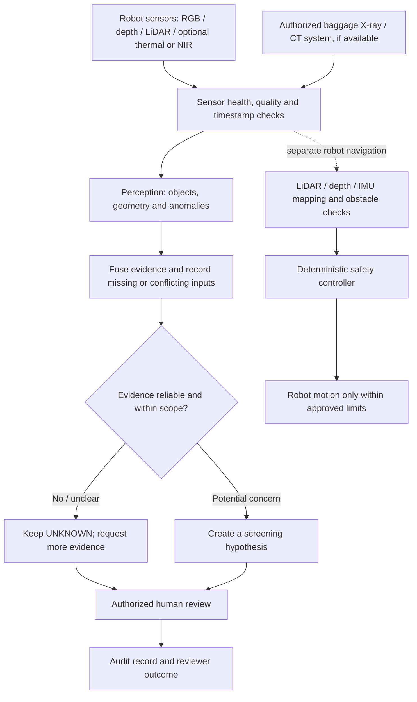
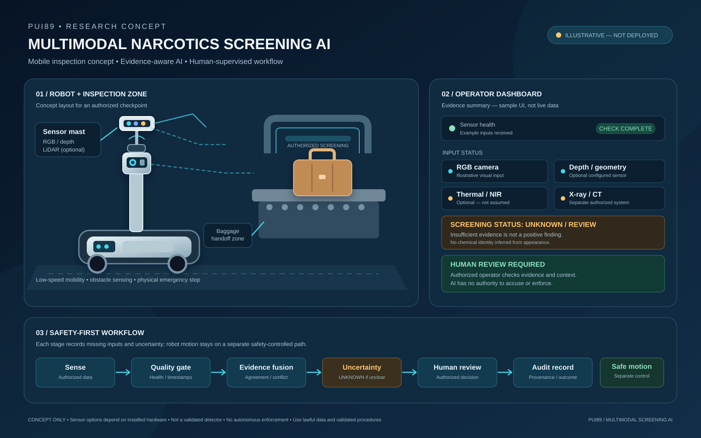
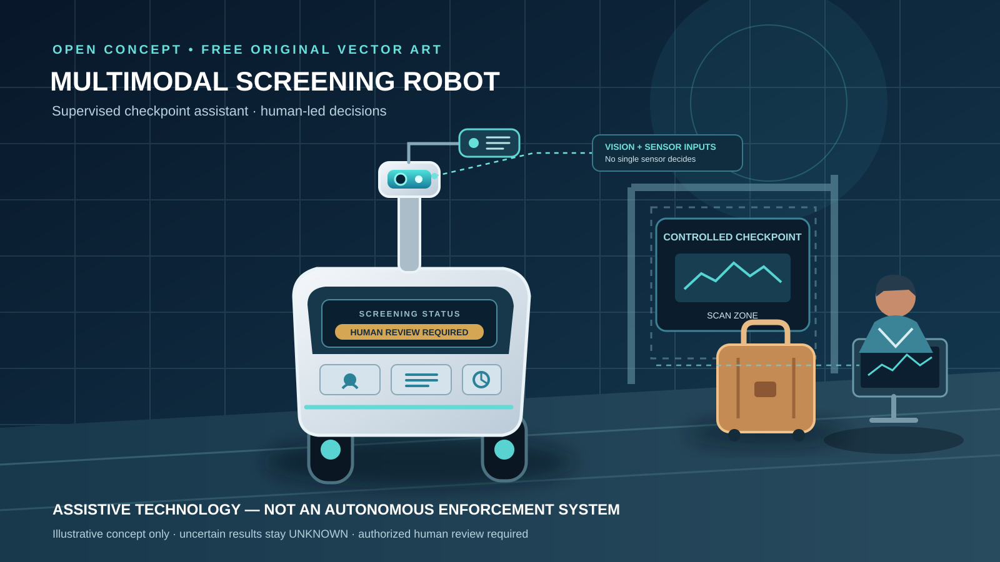

# Multimodal Narcotics Screening AI Application

## Free local Hugging Face model plan

This repository's recommended local model, intended tasks, licence checks, setup notes, and no-surprise-billing rules are documented in **[HUGGINGFACE_LOCAL_MODELS.md](docs/HUGGINGFACE_LOCAL_MODELS.md)**.

**Cost boundary:** the plan uses downloaded local weights only; it does not require paid Hugging Face inference, cloud GPUs, paid notebooks, or a subscription. Model integration and performance must be verified by running tests locally.


## New Robot Concept Image



Original project artwork showing a mobile inspection robot with RGB/depth/LiDAR sensors, luggage observation, a separate authorized X-ray/CT station, and an operator review console. **This is concept illustration—not a real photograph, deployed robot, chemical identification, or validated detector.** The system must preserve `UNKNOWN` when evidence is insufficient and require authorized human review.

## AI Application Overview

## How the AI application works

The AI application is the software layer that receives authorized sensor observations, checks data quality, combines supported evidence, reports uncertainty, and helps an authorized person review a case. The application can be tested on a computer with recorded or simulated data; connecting a physical robot is a separate integration step.

### Application workflow



1. **Input:** use only sensor data the project actually supports and that is authorized for the intended purpose. RGB, depth, thermal/NIR and LiDAR are possible modalities when appropriate hardware is connected. Authorized X-ray/CT baggage images are a separate input source when available.
2. **Quality gate:** check sensor health, image quality, timestamps, calibration and missing modalities.
3. **AI perception:** analyze supported visual features, object geometry or anomalies; do not infer facts that the sensors cannot observe.
4. **Evidence fusion:** compare available modalities and record agreement, contradictions and missing data.
5. **Uncertainty:** preserve `UNKNOWN` when evidence is insufficient or out of scope. A visual match is a screening hypothesis, not proof of chemical identity.
6. **Human review:** an authorized reviewer makes the consequential decision and the application records the review outcome.
7. **Evaluation:** test with documented, lawfully usable datasets and report false positives, missed cases, calibration and limitations before considering any field trial.

### Concept image and real-image reference



*Concept dashboard showing a proposed review interface. It is illustrative artwork, not a live application screenshot or proof of detector performance.*


*Real reference photograph from Wikimedia Commons: [Samples of drugs](https://commons.wikimedia.org/wiki/File:Samples_of_drugs.jpg), licensed CC0 1.0 according to its source page. It is used for documentation only, not as a validated training/evaluation dataset or evidence of any particular case.*

**Important limits:** ordinary RGB photos cannot reveal drugs hidden inside closed luggage, and a photo of a substance cannot reliably determine its chemical identity. Baggage screening requires a suitable authorized X-ray/CT system and data; chemical identity requires an authorized validated test or forensic procedure. This repository is a research prototype, not a validated airport detector.

## Free reproducible testing and evaluation

The repository includes API regression tests, evaluation-metric tests, a clearly labelled synthetic JSONL example, and a GitHub Actions workflow that runs on relevant pushes and pull requests. These checks use free/open-source Python tooling; hosted CI availability and quotas are controlled by GitHub.

- [Regression tests](apps/pui89_app/test_main.py)
- [Evaluation metrics tests](evaluation/test_metrics.py)
- [Synthetic example and evaluation guide](evaluation/README.md)
- [Automated regression workflow](.github/workflows/app-regression.yml)

Run locally from the repository root:

```bash
python -m pip install "fastapi>=0.110,<1.0" "pydantic>=2.6,<3.0"
python -m unittest apps.pui89_app.test_main evaluation.test_metrics -v
python evaluation/run_evaluation.py evaluation/examples/synthetic_predictions.jsonl --output reports/synthetic-evaluation.json
```

The sample results are synthetic teaching data, not narcotics-detection performance. The API still uses manually entered feature values and heuristic rules, not a trained image detector.

## Interactive AI application example

A local Streamlit dashboard is available to demonstrate the evidence-review workflow using manually entered sample values. You can toggle RGB/depth/thermal/LiDAR status, adjust timestamp alignment and illustrative anomaly/consistency scores, inspect `UNKNOWN` and human-review outcomes, and export a JSON report.

**Run from the repository root.** Install dependencies:

```bash
python -m pip install -r apps/pui89_app/requirements.txt
```

Terminal 1:
```bash
uvicorn apps.pui89_app.main:app --reload
```

Terminal 2:
```bash
streamlit run apps/pui89_app/web_demo.py
```

- [Dashboard source code](apps/pui89_app/web_demo.py)
- [Application setup and API guide](apps/pui89_app/README.md)
- [Interactive API documentation](http://127.0.0.1:8000/docs) after the API starts

**Important:** this is a local prototype, not a hosted public demo. Uploaded images are preview-only; no trained vision model analyzes them. The output uses manually entered example features and heuristic rules. It cannot identify chemical substances, prove narcotics are present, authorize enforcement, or control a robot. Use validated procedures and authorized human review.

## How the AI robot works

This section explains the proposed robot workflow using the concept illustrations and real, openly licensed reference photographs already linked in this README. The concept visuals show a design idea; they are not photographs of a deployed robot or evidence of validated narcotics-detection performance.

### Robot workflow at a glance



### What happens at each stage?

1. **Sense:** cameras and other configured sensors observe accessible objects and the surrounding environment. The robot may carry sensors, but each modality must actually be installed and integrated before it can be used.
2. **Check sensor quality:** the software checks whether observations are usable, synchronized and correctly attributed. Missing or degraded inputs are recorded rather than silently treated as evidence.
3. **Analyze:** computer-vision models can describe supported visual features, object geometry or anomalies. The application combines available signals and records disagreement.
4. **Express uncertainty:** if evidence is insufficient or unfamiliar, the system returns `UNKNOWN` or requests more data. A visual pattern is not chemical proof.
5. **Ask for human review:** an authorized officer evaluates the screening hypothesis and decides what, if anything, should happen next. The AI must not independently accuse, search, detain or make enforcement decisions.
6. **Move safely:** robot navigation is a separate control path using configured mapping and obstacle sensors plus deterministic safety controls. A foundation model or screening result must not directly command motors.
7. **Keep an audit trail:** record sensor provenance, model/software version, uncertainty, and the human review outcome according to the applicable privacy and evidence rules.

**Important limitation:** ordinary RGB photographs cannot reveal drugs hidden inside closed luggage, and a photo of a substance cannot reliably establish its chemical identity. Baggage X-ray/CT screening requires an appropriate authorized system and legally usable data. Chemical identity requires an authorized, validated test or forensic procedure.

### Concept visuals and real reference photos

- The [animated robot/application concept](docs/images/multimodal-screening-ai-demo.svg), [dashboard concept](docs/images/multimodal-ai-application-dashboard.svg), and [3D/4D robot concept](docs/multimodal_narcotics_screening_robot_3d_4d_concept.svg) illustrate a proposed interface and system design, not real-time operation.
- The real reference photos linked below have their own source and licence notes. They are included for visual context only, not as a validated training dataset, and must not be presented as photographs from a specific Thai arrest unless the original source confirms that provenance.
- For Thai airport case context, this README links to official government/customs reports instead of rehosting photos where open reuse permission is not clear.

### Open-licensed reference photograph: narcotics screening


**Image and cost note:** The remaining reference photograph is hosted by Wikimedia Commons and its source page identifies it as CC0/public domain, so no paid image subscription is required to reuse it under those stated terms. External hosting availability is not guaranteed. Do not use this reference photo as labelled training or evaluation data without checking dataset suitability and provenance.

### Thailand narcotics arrest and seizure reference (official source)

For a **real Thai law-enforcement context**, see the [Royal Thai Government photo gallery for the major narcotics-trafficking arrest announcement on 12 May 2026](https://www.thaigov.go.th/th/media/gallery/view/29367). Also see the [Thai Government / Customs report on 2026 drug seizures](https://www.thaigov.go.th/th/news/165914), which reports that methamphetamine (“ice”) and heroin were among the leading substances seized in the first nine months of fiscal year 2026.

**Copyright and evidence note:** These are official Thai case-report links, not open-licensed image files. I have linked to the original government pages rather than copying those photos into this repository because the pages do not clearly grant an open reuse licence. The Wikimedia Commons photos below are separate, openly licensed specimen/plant references; **they are not photographs of the Thai arrests or seizures**. This distinction avoids falsely presenting generic reference images as evidence from a particular case.

### Free, open-licensed reference images: ice, heroin and cannabis

These real photographs are included as **visual reference examples** for a research interface and documentation. They are not a labelled dataset, do not prove chemical identity, and must not be described as model-training or evaluation evidence.

#### Crystal methamphetamine (“ice”)


*Photo: WikiLinuz, [Crystal methamphetamine (2).jpg](https://commons.wikimedia.org/wiki/File:Crystal_methamphetamine_(2).jpg), released under [CC0 1.0](https://creativecommons.org/publicdomain/zero/1.0/). The licence permits reuse without attribution, though attribution is provided here for provenance.*

#### Heroin


*Photo: DMTrott, [Heroin (Drug).jpg](https://commons.wikimedia.org/wiki/File:Heroin_(Drug).jpg), licensed under [CC BY-SA 4.0](https://creativecommons.org/licenses/by-sa/4.0/). Credit the author, link the licence, note any changes, and share adaptations under the same or a compatible licence.*

#### Cannabis plant


*Photo: Jorge Barrios, [Marijuana plant.jpg](https://commons.wikimedia.org/wiki/File:Marijuana_plant.jpg), released into the [public domain](https://creativecommons.org/publicdomain/zero/1.0/).*

**Cost and responsible-use note:** The cited source pages list these images as CC0/public domain or CC BY-SA 4.0, so no paid stock-photo subscription is required for reuse under those licence terms. Images are loaded from Wikimedia Commons; external hosting can change, and this does not guarantee that future cloud, API, storage or compute services will be free. Visual appearance alone cannot identify a substance reliably—use authorized, validated chemical testing for confirmation.


Multimodal AI application concept for authorized screening support using sensor-quality checks, evidence fusion, open-set/UNKNOWN handling, uncertainty reporting, and mandatory human review.


> **Status and evidence:** This repository documents a research/prototype workflow. The illustration is concept artwork, not a live demonstration or proof of field performance. Reported capability and performance must be supported by reproducible tests and benchmark results.

### Platform scope: AI application + embodied robotics

**This platform is designed to support both an AI application and an embodied robotic screening concept.** These are two connected layers of one research platform:

- **AI application layer (runs on a computer):** review sensor inputs, fuse multimodal evidence, check sensor/data quality, report uncertainty and UNKNOWN cases, present findings for authorized human review, and maintain an auditable record.
- **Embodied robotics layer (robot-facing architecture):** provide a path to connect approved sensing and inspection workflows to a simulated or physical mobile/inspection robot through interfaces such as ROS 2, with localization, inspection planning, obstacle/safety checks, operator oversight, and controlled integration boundaries.
- **Shared pipeline:** sensor/data quality → multimodal evidence fusion → uncertainty/UNKNOWN handling → reviewable screening proposal → human decision → audit record.

The AI application can be developed and evaluated on a computer without robot hardware. The embodied layer is an intended integration concept, **not proof of a validated narcotics detector, completed physical robot integration, or permission for autonomous enforcement or consequential action against a person.** Outputs must remain uncertain screening evidence for authorized human review; begin with synthetic/recorded data and simulation, and require independent evaluation and safety/privacy review before real-world use.


### Quick start

Clone the renamed repository and install the project dependencies:

```bash
git clone https://github.com/Pui89/Multimodal-Narcotics-Screening-AI.git
cd Multimodal-Narcotics-Screening-AI
python -m pip install --upgrade pip
python -m pip install -e '.[dev]'
python demo_end_to_end.py
pytest -q
```

The end-to-end demo and tests are intended for local development with the project's documented inputs. Start with synthetic or recorded data; do not connect the prototype directly to physical actuators or use it as the sole basis for consequential decisions.

**Workflow:** sensor/data quality checks → perception and multimodal evidence → 3D/temporal scene representation → uncertainty and unknown-case handling → reviewable plan or screening proposal → audit record.

**Documentation:** [End-to-end simulation workflow](docs/END_TO_END_SIMULATION.md) · [End-to-end verification](docs/E2E_VERIFICATION.md) · [Evaluation guide](docs/EVALUATION.md) · [Reproducible benchmark plan](docs/EVALUATION_BENCHMARK.md)

### Animated AI application demo



*This is an animated SVG concept visualization, not a recorded 4D video, a live sensor feed, or proof of real-world performance.*


## PUI89 AI Robotics Platform

**Multimodal AI security and inspection platform with evidence-aware screening, uncertainty and human review.**

This repository is one vertical implementation of the **PUI89 AI Robotics** platform for security / inspection. The common architecture is:

```text
Multimodal Sensors
      ↓
Quality / Health Gate
      ↓
Perception + Tracking
      ↓
3D / 4D World Model
      ↓
Uncertainty + OOD
      ↓
Foundation-Model Reasoning
      ↓
Task Planning
      ↓
Deterministic Safety Supervisor
      ↓
ROS 2 / Robot Control
      ↓
Telemetry / Evidence
      ↓
MLOps / Fleet Learning
```

### Product tiers

- **PUI89 Research** — universities, robotics competitions, researchers
- **PUI89 Professional** — industrial customers, logistics, ports, infrastructure, authorized security operators
- **PUI89 Enterprise** — large corporations, governments, logistics, ports, infrastructure

### Cross-environment research

The same perception/world-model/uncertainty/safety interfaces are designed to transfer between agriculture, disaster response and security/inspection. Transfer must be measured with the repository benchmark; it is not assumed from architecture alone.

- [Optional DINOv2 + Anomalib integration, end-to-end verification and tests](docs/OPEN_SOURCE_VISION_INTEGRATION.md)

### Evidence standard

This project separates **targets, prototypes and measured results**. Production or field-validation claims require reproducible benchmark evidence, failure testing, and documented safety validation.

See:
- [PUI89 Benchmark](docs/PUI89_BENCHMARK.md)
- [Cross-Environment Transfer Benchmark](docs/PUI89_TRANSFER_BENCHMARK.md)
- [Product Tiers](docs/PUI89_PRODUCT_TIERS.md)
- [Failure and UNKNOWN Protocol](docs/PUI89_FAILURE_AND_UNKNOWN_PROTOCOL.md)
- [MLOps Model Lifecycle](docs/PUI89_MLOPS_MODEL_LIFECYCLE.md)
- [Research, Competition and Commercial Evidence](docs/PUI89_RESEARCH_COMPETITION_INVESTOR.md)
- [12-Month Roadmap](docs/PUI89_12_MONTH_ROADMAP.md)
- [Cost Safety and Billing Policy](docs/COST_SAFETY_AND_BILLING.md)

Defensive, non-invasive AI platform for screening accessible external objects and environments for anomalous substances and suspected narcotics-related visual patterns, with multimodal evidence fusion, uncertainty handling, human review, and safe robotics integration.

SAFETY: ordinary cameras, thermal/NIR, depth, LiDAR, and AI models cannot reliably identify a drug hidden inside a person's organs or determine whether someone has ingested a substance. This project does not perform internal-body diagnosis, medical examination, forensic chemical identification, restraint, seizure, or autonomous enforcement. Suspected ingestion/internal-body cases require qualified medical/forensic professionals using validated procedures.

## Stack

- RGB/RGB-D/thermal/NIR/LiDAR perception
- YOLO-family detection, SAM3-style segmentation, tracking
- 3D localization and evidence geometry
- open-set anomaly and unknown handling
- Qwen3-VL and Gemma4-E4B-it as review aids
- V-JEPA2-style temporal representation
- ROS2/Nav2, LiDAR/depth/IMU SLAM, optional MPC
- MQTT/WebSockets telemetry
- Isaac Sim/Isaac Lab and LeRobot simulation hooks
- deterministic safety gate before robot motion

## Screening taxonomy

amphetamine, heroin, methamphetamine_crystal, narcotic_unknown, unknown_substance

Predictions are screening hypotheses only, never proof of chemical identity. Unknown and unseen observations remain unknown.

## Architecture

RGB/RGB-D/Thermal/NIR/LiDAR -> detection/segmentation/tracking -> 3D evidence fusion -> anomaly/unknown screening -> multimodal reasoning -> uncertainty calibration -> HUMAN REVIEW -> audit/evidence record.

Navigation is separate: LiDAR/Depth/IMU -> SLAM/local map -> Nav2/planner/MPC -> deterministic safety gate -> ROS2 controller. Foundation models never directly command motors.

## Quick start

```bash
python -m pip install -e '.[dev]'
python demo_end_to_end.py
pytest -q
```

The demo uses synthetic, explicitly unknown observations to exercise quality gating, temporal alignment, human-review output and the audit record. It does not run a validated narcotics detector, identify chemical composition, or authorize robot motion. See [End-to-End Verification](docs/E2E_VERIFICATION.md).

## Executable End-to-End Baseline

The repository now contains an executable **software-level end-to-end reference pipeline**:

`normalized sensor observations → sensor-quality gate → temporal alignment → multimodal evidence aggregation → uncertainty/UNKNOWN abstention → mandatory human review → auditable evidence record`.

This is an integrated reference workflow, not yet proof that every physical sensor, foundation model, ROS 2 node, or robot actuator is integrated into one validated hardware system.

### Run it

```bash
python -m pip install -e '.[dev]'
pytest -q
```

Example using recorded or simulated observations:

```python
from pui89_e2e import EndToEndScreeningPipeline, SensorObservation

observations = [
    SensorObservation(
        sensor_id="camera-01",
        modality="rgb",
        timestamp="2026-10-09T10:00:00+00:00",
        quality=0.92,
        candidate_label="unknown_substance",
        confidence=0.0,
    ),
    SensorObservation(
        sensor_id="depth-01",
        modality="depth",
        timestamp="2026-10-09T10:00:00+00:00",
        quality=0.95,
        candidate_label="unknown_substance",
        confidence=0.0,
    ),
]

result = EndToEndScreeningPipeline().run(observations, case_id="demo-001")
print(result.to_dict())
```

The input observations above are illustrative test data, not live sensor readings or a validated narcotics detection result. The pipeline rejects poor-quality or temporally misaligned evidence, preserves UNKNOWN when no supported hypothesis exists, produces a traceable evidence ID and audit record, and always requires human review. It **never authorizes robot motion** and does not identify chemical composition.

Implementation: [`src/pui89_e2e/pipeline.py`](src/pui89_e2e/pipeline.py). Tests: [`tests/test_e2e_pipeline.py`](tests/test_e2e_pipeline.py).

## End-to-End Verification

The pipeline includes an independent verification function for evidence integrity and safety invariants. It checks the evidence ID against the recorded payload, consistency between output and audit fields, valid confidence/status/counts, preservation of UNKNOWN on abstention, mandatory human review, and that robot motion remains unauthorized.

```python
from pui89_e2e import verify_pipeline_result

report = verify_pipeline_result(result)
if not report.valid:
    print("Verification errors:", report.errors)
```

Run the automated suite with `pytest -q`. Verification tests include record tampering, attempted motion authorization, missing human review, and abstention checks.

Full details: [End-to-End Verification](docs/E2E_VERIFICATION.md).

**Security limitation:** the current evidence ID is an unkeyed digest for integrity consistency, not a cryptographic signature or proof of who created/reviewed a record. Passing software checks does not validate detection accuracy, chemical identity, or real-world robot safety.

## Ethics

Use only lawful, authorized and proportionate screening. Minimize retained imagery, protect evidence access, log reviewer decisions, and avoid demographic or unrelated person identification.

## 3D / 4D Robot Concept


Realistic concept visualization of the mobile screening robot, sensor mast, screening target, multimodal sensor fusion and time-indexed 4D trajectory. The visualization is a design concept, not a claim of chemical identification capability.

- [3D/4D concept image](docs/multimodal_narcotics_screening_robot_3d_4d_concept.svg)
- [3D/4D video preview](docs/multimodal_narcotics_screening_robot_3d4d_preview.mp4)

## Pipeline Overview

**Sense → Quality Gate → Perceive → Track → 3D Evidence Fusion → Anomaly/Unknown Screening → Multimodal Reasoning → Uncertainty Calibration → Human Review → Audit → Safe Robot Navigation**

See [Pipeline Overview](docs/PIPELINE_OVERVIEW.md) for the full safety-first workflow and [AI Architecture](docs/AI_ARCHITECTURE.md) for the multimodal system diagram.

> Safety note: screening outputs are hypotheses for authorized human review. They are not proof of chemical identity, and foundation models do not directly control robot motors.


## News

Project updates, releases, architecture changes, evaluation milestones, and safety-related changes will be documented in Git history and release notes. No experimental result is presented as validated until it has been reproduced and documented.

## Online API

**Status: Prototype / planned interface**

The intended API will expose screening and evidence-processing services without providing direct actuator control.

Example conceptual request:

~~~json
{
  "request_id": "example-001",
  "modalities": ["rgb", "depth", "thermal", "lidar"],
  "mode": "screening"
}
~~~

Example conceptual response:

~~~json
{
  "screening_hypothesis": "unknown_substance",
  "confidence": 0.0,
  "uncertainty": 0.0,
  "decision": "HUMAN_REVIEW",
  "evidence_provenance": {}
}
~~~

Values above are interface examples only, not measured results.

## Online App

**Status: Prototype / planned**

The planned web interface will provide:

- live sensor status
- synchronized RGB/depth/thermal/LiDAR views
- 3D evidence visualization
- uncertainty and OOD indicators
- screening history and audit trail
- human-review workflow
- robot telemetry
- safety-state and emergency-stop status

The application will not expose unrestricted AI-to-motor control.

## System Overview

~~~text
Sensors
  │
  ├── RGB / RGB-D
  ├── Thermal / NIR
  ├── LiDAR
  └── IMU
       │
       ▼
Sensor Synchronization + Quality Gate
       │
       ▼
Detection / Segmentation / Tracking
       │
       ▼
3D Evidence Fusion
       │
       ├──────────────► SLAM / Local Map ─► Planner
       │                                  │
       ▼                                  ▼
Open-Set / Anomaly Screening       Deterministic Safety Gate
       │                                  │
       ▼                                  ▼
Multimodal Reasoning                  ROS 2 Controller
       │
       ▼
Uncertainty / OOD Calibration
       │
       ▼
Human Review
       │
       ▼
Audit / Evidence Record
~~~

Foundation models remain advisory components and are isolated from direct actuator control.

## Model Variants and Input Specifications

The repository is designed to support modular model variants rather than requiring a single model.

| Variant | Primary inputs | Purpose | Status |
|---|---|---|---|
| RGB | RGB image | baseline visual perception | Prototype |
| RGB-D | RGB + depth | object geometry and localization | Prototype |
| Thermal/NIR | thermal/NIR | complementary spectral evidence | Planned |
| LiDAR | point cloud | 3D geometry and mapping | Prototype |
| Multimodal | RGB-D + thermal/NIR + LiDAR | evidence fusion | Prototype |
| Temporal | sequential multimodal observations | temporal evidence | Planned |
| Open-set | multimodal + OOD features | unknown handling | Prototype |
| Review model | multimodal evidence | human-review assistance | Prototype |

Input specifications should be treated as hardware/configuration dependent. Sensor calibration, synchronization, resolution, frame rate, field of view, and preprocessing must be recorded for each deployment.

## Model Architecture

The architecture separates perception, evidence fusion, reasoning, uncertainty estimation, and robot control:

~~~text
RGB/RGB-D ───────┐
Thermal/NIR ─────┤
LiDAR ───────────┤
IMU ─────────────┘
        │
        ▼
Quality Gate
        │
        ▼
Perception
(detection / segmentation / tracking)
        │
        ▼
Multimodal Evidence Fusion
        │
        ├──► Open-Set / OOD
        ├──► Temporal Representation
        └──► 3D Evidence Map
        │
        ▼
Reasoning / Evidence Summary
        │
        ▼
Uncertainty Calibration
        │
        ▼
Human Review
        │
        ▼
Audit Record

Navigation:
LiDAR + Depth + IMU
        │
        ▼
SLAM → Local Map → Planner
        │
        ▼
Deterministic Safety Gate
        │
        ▼
ROS 2 Controller
~~~

## Recommended Workflow

1. Calibrate and synchronize available sensors.
2. Validate sensor health and quality.
3. Acquire accessible external-object/environment observations.
4. Run perception and tracking.
5. Fuse spatial and multimodal evidence.
6. Evaluate unknown/OOD status.
7. Generate an uncertainty-aware screening hypothesis.
8. Send consequential cases to authorized human review.
9. Record evidence provenance and reviewer outcome.
10. Run navigation only through deterministic safety controls.
11. Review failures before deploying a new model version.

## Local Deployment

**Status: Local development / prototype deployment**

The recommended deployment path is to validate the screening pipeline with recorded or simulated sensor data first, then add sensors and robotics interfaces incrementally. Screening outputs remain hypotheses for authorized human review and are never treated as proof of chemical identity.

### Requirements

- Python 3.x
- Git
- project dependencies from `pyproject.toml`
- ROS 2 for optional robotics integration
- compatible RGB/RGB-D, thermal/NIR, LiDAR and/or IMU hardware as configured
- optional NVIDIA GPU for deep-learning inference
- optional simulator such as Isaac Sim/Isaac Lab for robotics testing

### Clone and install

~~~bash
git clone https://github.com/Pui89/Multimodal-Narcotics-Screening-AI.git
cd Multimodal-Narcotics-Screening-AI

python -m venv .venv
source .venv/bin/activate
# Windows PowerShell:
# .venv\\Scripts\\Activate.ps1

python -m pip install --upgrade pip
python -m pip install -e '.[dev]'
~~~

### Validate the local environment

~~~bash
python --version
python -m pip check
pytest -q
~~~

### Recommended deployment sequence

~~~text
Recorded / simulated data
        │
        ▼
Environment + dependency validation
        │
        ▼
Sensor calibration / synchronization
        │
        ▼
Perception + tracking
        │
        ▼
Multimodal evidence fusion
        │
        ▼
Open-set / uncertainty checks
        │
        ▼
Human review + audit record
        │
        ▼
Optional ROS 2 / navigation integration
        │
        ▼
Deterministic safety gate
~~~

### Sensor deployment

For each deployment, record:

- camera/depth/thermal/NIR/LiDAR/IMU model and configuration
- resolution, frame rate, field of view and operating range
- intrinsic/extrinsic calibration
- timestamp synchronization method
- preprocessing and model version
- sensor-health status and missing modalities
- evidence provenance and reviewer outcome

### Robotics integration

ROS 2 integration should be enabled only after the perception and safety pipeline has been validated. Navigation and motion remain separate from multimodal reasoning:

~~~text
Sensors → Perception → Evidence Map → Reasoning
                                      │
                                      ▼
                               Human Review
                                      │
LiDAR + Depth + IMU → SLAM → Planner → Safety Gate → ROS 2
~~~

Foundation models must not directly command motors, cutters, manipulators, or other actuators. Emergency-stop and deterministic safety controls remain authoritative.

### Troubleshooting

- If editable installation fails, confirm Python version and that `pyproject.toml` is present.
- If tests fail, resolve dependency/environment issues before connecting physical hardware.
- If a sensor stream is missing or degraded, preserve the observation as unknown rather than forcing a screening classification.
- If ROS 2 is unavailable, continue development with recorded/simulated data rather than bypassing the safety/control boundary.

### Development principle

Start with recorded/simulated sensor data, validate perception, uncertainty handling and safety gates, then connect hardware incrementally. Never connect an unvalidated foundation model directly to actuators.

## Full 2K-Workflow

**2K refers to the target high-resolution visual processing workflow and should not be interpreted as a guaranteed camera input specification.**

~~~text
2K RGB acquisition
      │
      ▼
Quality check + synchronization
      │
      ▼
Resize / crop / preprocessing
      │
      ▼
Detection + segmentation
      │
      ▼
Depth / thermal / LiDAR alignment
      │
      ▼
3D evidence fusion
      │
      ▼
Open-set + uncertainty analysis
      │
      ▼
Human review
      │
      ▼
Audit / export
~~~

Actual supported resolution depends on the camera, compute hardware, memory budget, and configured inference pipeline.

## Prompting Guidance

Foundation models should be prompted as **evidence-review assistants**, not as autonomous chemical identifiers or robot controllers.

Recommended structure:

~~~text
ROLE:
You are an evidence-review assistant.

INPUT:
Describe only the supplied sensor observations and metadata.

TASK:
1. Summarize observable evidence.
2. Identify missing or degraded modalities.
3. Identify contradictions between modalities.
4. State uncertainty.
5. Preserve UNKNOWN when evidence is insufficient.
6. Recommend HUMAN_REVIEW when the evidence is consequential or ambiguous.

CONSTRAINTS:
Do not claim chemical identity from visual evidence alone.
Do not infer ingestion or internal-body presence.
Do not issue actuator commands.
Do not convert uncertainty into certainty.
~~~

Prompts and model outputs must remain subordinate to deterministic safety controls and human review.

## Production-Quality Platform Layer

The repository now includes a deterministic baseline for multimodal evidence fusion, sensor-quality gating, open-set abstention, uncertainty estimation, and audit-oriented evidence graphs. These components are deliberately model-agnostic so validated perception models can be upgraded without changing the safety boundary.

### New capabilities
- Multimodal evidence fusion with cross-modal agreement and contradiction signals.
- Sensor health, synchronization and degraded-modality handling.
- Open-set screening with explicit UNKNOWN/ABSTAIN behavior.
- Uncertainty estimation that incorporates confidence, modality agreement, sensor quality and OOD score.
- Evidence graph with SHA-256 integrity digest for audit records.
- Reproducible evaluation metrics including classification metrics and expected calibration error.
- Robustness and sensor-failure evaluation guidance.
- Static evaluation dashboard at `dashboard/index.html` with no actuator authority.

### Evaluation and evidence
See `docs/EVALUATION.md`, `docs/ROBUSTNESS.md`, `docs/SENSOR_FAILURE.md`, `docs/EVIDENCE_GRAPH.md`, `docs/MODEL_REGISTRY.md`, and `docs/DASHBOARD.md`.

### Safety behavior
When confidence is insufficient, modalities disagree, sensors are degraded, or an observation is outside the configured screening envelope, the platform can abstain and require human review. Missing modalities are recorded as missing evidence rather than treated as negative evidence.

These improvements do not change the project's core limitation: visual/multimodal AI is a screening aid and cannot establish chemical identity, diagnose ingestion/internal-body presence, or authorize enforcement actions.

## Production Hardening

The project now includes additional engineering controls for secure, reproducible development:

- GitHub Actions dependency review and CodeQL workflows.
- Dependabot configuration for Python and GitHub Actions dependencies.
- CODEOWNERS coverage for source, evaluation, schemas, simulation and workflow infrastructure.
- Repository credential-pattern checks in CI.
- Versioned dataset/event schema in `schemas/screening_event.schema.json`.
- Dataset and annotation guidance in `docs/DATASET_AND_ANNOTATION.md`.
- Reproducible JSONL evaluation runner in `evaluation/run_evaluation.py`.
- Controlled robustness benchmark scenarios in `docs/ROBUSTNESS_BENCHMARK.md`.
- Dry-run robotics boundary in `simulation/`; it records navigation intent and does not issue actuator commands.
- Example model registry record in `config/model_registry.example.json`.
- Read-only, no-new-privileges Docker examples for development/evaluation services.

GitHub's dependency-review and secure-workflow guidance supports reviewing dependency changes, restricting workflow permissions, and using CodeQL for code scanning. These controls are configured as repository workflows rather than claims that the project is already certified or production-approved.

## Engineering Maturity

```text
Dataset Schema ──► Reproducible Evaluation ──► Calibration / OOD
       │                    │                         │
       ▼                    ▼                         ▼
 Provenance            Metrics / Reports       Safe Abstention
       │                    │                         │
       └──────────────► Human Review ◄───────────────┘
                              │
                              ▼
                    Evidence / Audit Record
                              │
                              ▼
                 Deterministic Safety Gate
                              │
                              ▼
                         ROS 2 / Robot
```

Hardware deployment remains conditional on independent validation of the sensing stack, safety controls, emergency-stop path, operating environment, and applicable authorization.

## License

This project is released under the **MIT License**. See [LICENSE](LICENSE).

Third-party models, datasets, SDKs, and dependencies may have separate licenses and terms. Users are responsible for complying with those terms.

## Contact Us

**GitHub:** [Pui89](https://github.com/Pui89)

For project issues, feature requests, implementation discussions, and reproducibility questions, use the repository's GitHub Issues and Discussions where available.

## Platform v1.0 Engineering Layer

This release adds a production-oriented engineering layer without expanding the unsafe capability boundary:

- runtime monitoring for latency, dropped frames, sensor health, synchronization drift, OOD and abstention
- bounded temporal evidence accumulation and covariance-aware 3D evidence quality
- explicit human-review records: ACCEPT / REJECT / UNKNOWN / REQUEST_MORE_DATA
- model lifecycle governance: candidate → validation → calibration → safety review → approved → deployed → monitored → retired
- reproducible experiment metadata and robustness stress scenarios
- framework-neutral service contract for `/screen`, `/health`, `/metrics`, `/models`, `/events/{id}`, and `/review`
- digital-twin and operator-interface contracts
- tagged release workflow with SHA-256 checksums, SPDX SBOM and GitHub artifact attestations

See [Platform v1.0](docs/PLATFORM_V1.md), [API Contract](docs/API_CONTRACT.md), [Research Tracking](docs/RESEARCH_TRACKING.md), [Digital Twin](docs/DIGITAL_TWIN.md), [Operator UI](docs/OPERATOR_UI.md), and [Secure Release Flow](docs/SECURE_RELEASE_FLOW.md).

Artifact attestations establish build provenance and can carry SBOMs; published artifacts should be verified before deployment.


## Free tools, funding and hardware support

See [Free and Open-Source Resources, Funding, Compute and Hardware Support](docs/OPEN_SOURCE_FREE_RESOURCES_AND_SUPPORT.md) for open-source tools, eligible grant and cloud-credit routes, potential hardware-loan contacts, project-specific priorities, and 2026–2028 planning. Support is competitive and subject to each program's current eligibility and terms; no funding or hardware is guaranteed.

## Optional Local Voice Alerts

This project includes an optional guide for adding local text-to-speech announcements with no hosted inference API required. Start with the [Voice Alerts guide](docs/VOICE_ALERTS.md). This is documentation and a manual smoke test only; voice output is not yet connected to live project events or validated for field use.

## Robot Design Concept

See the [low-cost robot design concept and staged safety plan](docs/ROBOT_DESIGN.md). This is a concept and prototype roadmap, not a claim of a tested or field-ready robot. The initial approach prioritizes local software, existing hardware, no paid hosted APIs, and human supervision.


## New Robot Concept Design

A separate visual concept and implementation outline is available here:

- [Multimodal screening robot concept guide](docs/MULTIMODAL_SCREENING_ROBOT_CONCEPT.md)
- 

This is illustrative design artwork, not a deployed robot or evidence of validated screening performance. The workflow preserves uncertainty and requires authorized human review; it does not infer chemical identity from ordinary photographs or authorize enforcement.

## Free AI Robot Concept Image



This is original, project-created SVG concept artwork stored directly in this repository. It requires no stock-photo subscription or paid image API. You can view, download, and reuse the SVG under the repository's MIT License, subject to any applicable third-party asset terms elsewhere in the project. The drawing is illustrative only; it does not represent a built robot or a validated narcotics detector. Results must remain uncertain when evidence is insufficient, with authorized human review required.
