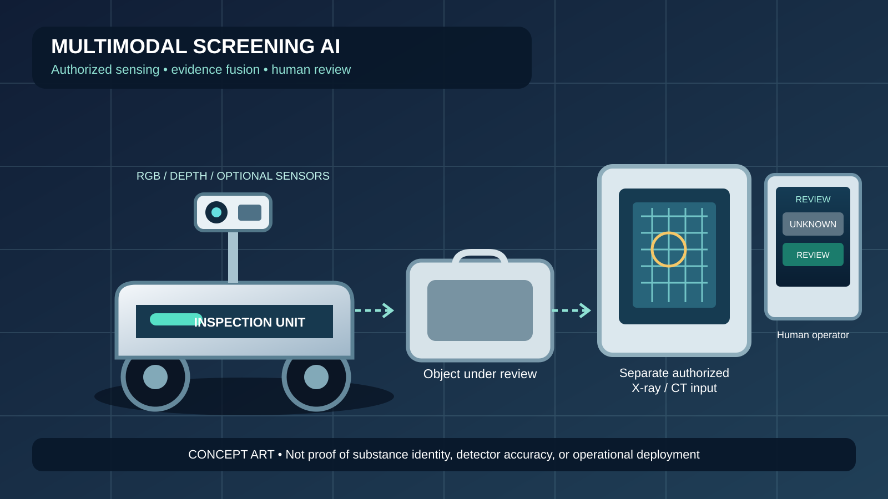

# Multimodal Narcotics Screening AI

> **Product quality standard:** [benchmark protocol and fair comparison criteria](docs/PRODUCT_BENCHMARK_STANDARD.md). This workflow prototype is **not validated** for narcotics detection or chemical identification. Appearance alone cannot establish chemical identity; no validated identification claim is made.

> **Next research milestone — controlled evaluation:** define one narrow, authorised screening task and its ground-truth source; document which modalities are genuinely available; test missing, conflicting, and uncertain inputs; and report false positives, false negatives, and human-review outcomes on independent, expert-reviewed data. Until such data and validation exist, the dashboard remains a manually populated workflow prototype—not a trained narcotics detector or chemical-identification system. See the [validation matrix](docs/VALIDATION_MATRIX.md).

## Support, sponsorship and open-source collaboration

PUI89 welcomes open-source contributions, multimodal evaluation expertise, authorised data-governance guidance, independent technical review, and scoped research or sponsorship discussions.

- **Support and sponsorship brief:** [ways to collaborate with PUI89](https://github.com/Pui89/Pui89.github.io/blob/main/SUPPORT_AND_SPONSORSHIP.md)
- **Project website:** [PUI89 AI Robotics](https://pui89.github.io/)

Any data or testing proposal must be authorised, privacy-reviewed, and legally appropriate. Outputs are decision-support research only; images alone cannot establish chemical identity, and AI must not independently trigger enforcement action.

## Latest engineering update — 21 October 2026

- **Safety input validation:** [PR #14](https://github.com/Pui89/Multimodal-Narcotics-Screening-AI/pull/14) is merged. The software gate rejects malformed thresholds and invalid navigation inputs rather than treating ambiguous values as safe.
- **Automated checks:** the two GitHub Actions workflows for the PR passed before merge.
- **Evidence boundary:** these checks establish software input-validation behavior only. They do not validate a narcotics detector, prove chemical identity, or establish physical robot safety. Real held-out data and authorized expert-reviewed labels are still needed before reporting detector performance.

## Thailand case reference: hashish seizure in Bangkok (reported 6 November 2024)

Thai PBS World reported that Thai anti-narcotics police arrested two foreign nationals, described as British and Dutch, at a rented condominium in Bangkok and seized **36 kg of dried cannabis and 1.4 kg of hashish**. The report said documents found at the location indicated plans to mail packages to England. This is a reported law-enforcement case, not a claim of a court finding or conviction.

- **Source:** [Thai PBS World — Two foreigners arrested in Bangkok preparing to ship 36kg of weed to the UK](https://www.thaipbsworld.com/crime/two-foreigners-arrested-in-bangkok-preparing-to-ship-36kg-of-weed-to-the-uk) (6 November 2024).
- **Relevance to this project:** this case can inform discussion of authorised screening workflows, evidence provenance, and human review. It is **not** a model-training example or a validated benchmark item; no case-specific image or verified ground-truth dataset is included here.
- **Important limitation:** photos of cannabis or hashish cannot establish chemical identity. Any future evaluation would require lawfully obtained, appropriately licensed data and expert-confirmed labels, with independent test splits and false-positive/false-negative reporting. AI output must remain decision support for authorised human reviewers and must not independently trigger enforcement action.

## Potential future screening categories — not yet implemented

The categories below are possible future research scopes, not current model capabilities or confirmed training labels:

- **Dried cannabis** — dried plant material.
- **Hashish / cannabis resin** — a resin-derived cannabis product; keep it distinct from dried plant material in any annotation scheme.
- **Methamphetamine**
- **Cocaine**
- **Heroin**

**Implementation and evidence status:** these are proposed categories only. The repository does not claim that a trained model can detect or identify these substances. Do not label photographs as confirmed substances based on appearance alone. Any future dataset must be lawfully obtained, appropriately licensed, provenance-documented, and labelled using suitable analytical evidence and qualified expert review. Evaluate each class on independent held-out data and report false positives, false negatives, uncertainty, and human-review outcomes before making performance claims.

**Image policy:** prefer linking to the original official or reputable source unless image reuse permission is confirmed. Clearly distinguish illustrative case photographs from model-training data and benchmark samples.

## Robot concept illustration

*Original concept artwork—not a validated narcotics detector or proof of substance identity.*

> **Complete-system architecture and acceptance gates:** [COMPLETE_SYSTEM_BLUEPRINT.md](docs/COMPLETE_SYSTEM_BLUEPRINT.md). This is a build-and-validation plan, not a claim of validated narcotics identification.
> **Current validation matrix:** [VALIDATION_MATRIX.md](docs/VALIDATION_MATRIX.md) — implementation evidence, automated checks, and remaining unvalidated capabilities.
> **Engineering assurance plan:** [ENGINEERING_ASSURANCE_PLAN.md](docs/ENGINEERING_ASSURANCE_PLAN.md) — project requirements, hazard log, verification/validation gates, and evidence rules.

## Local Hugging Face model plan

This repository's recommended local model, intended tasks, licence checks, setup notes, and no-surprise-billing rules are documented in **[HUGGINGFACE_LOCAL_MODELS.md](docs/HUGGINGFACE_LOCAL_MODELS.md)**.

**Cost boundary:** the plan uses downloaded local weights only; it does not require paid Hugging Face inference, cloud GPUs, paid notebooks, or a subscription. Model integration and performance must be verified by running tests locally.

**Dataset and labelling workflow:** see [dataset sources, licence checks, annotation and training plan](docs/DATASET_ACQUISITION_AND_LABELING.md), the [Windows opt-in dataset helper](scripts/prepare_free_datasets.ps1), the [image inventory/manifest generator](tools/dataset_inventory.py), the [manifest template](data/manifest.template.csv), the [group-aware train/validation/test splitter](tools/group_split_manifest.py), and the [local manifest audit tool](tools/audit_dataset_manifest.py). Downloads require local user confirmation; no images are automatically considered licensed or correctly labelled. Keep datasets and weights out of Git.

[Detailed project status, checks, next steps and future plan](docs/PROJECT_STATUS_2026-10-18.md)

[Product brief and release gates](docs/PRODUCT_BRIEF.md)

## Latest automated CI verification — 20 October 2026

The latest local-first regression workflow passed on the current main-branch change in [run 39276822504](https://github.com/Pui89/Multimodal-Narcotics-Screening-AI/actions/runs/39276822504). It checks API/evaluation software, dataset-manifest safeguards, and the synthetic evaluation pipeline. Synthetic test results are not real screening benchmarks and do **not** establish narcotics identification or chemical identity.

## Latest status update — 20 October 2026

- **Current status: screening workflow prototype; not a validated narcotics detector.** The validation matrix was refreshed on 20 October to match [the latest passing CI run](https://github.com/Pui89/Multimodal-Narcotics-Screening-AI/actions/runs/39276822504). The tests verify software behavior only; synthetic scores are not real screening-accuracy results.
- **Data readiness:** obtain lawful, authorised, appropriately licensed and expert-reviewed data before model evaluation. Record provenance and annotation rules, prevent duplicate/source leakage across splits, and document which modalities are genuinely available and aligned.
- **Next checks:** test missing, stale and conflicting modalities; verify confidence calibration and the ability to abstain as `UNKNOWN`; compare single-modality baselines with multimodal fusion only when suitable aligned real data exist; report false positives, false negatives, calibration and failure cases.
- **Not yet demonstrated:** a trained model validated on a representative independent dataset, reliable chemical identification, validated multimodal sensor fusion, or a validated physical screening robot. Ordinary RGB images cannot establish chemical identity or reveal contents hidden inside closed luggage.
- **Human review and rights:** any screening output is a hypothesis for an authorised reviewer, not proof of a substance or grounds for automatic enforcement. Preserve privacy, auditability and documented review.
- **Cost boundary:** remain cost-conscious and local-first where feasible; local model plans do not mean that model integration or accuracy has already been verified.

## Previous status update — 18 October 2026

- **Successful:** Python CI passed on 3.10/3.11/3.12 in [run 39096448541](https://github.com/Pui89/Multimodal-Narcotics-Screening-AI/actions/runs/39096448541); local API/dashboard and synthetic evaluation checks are present. This does not establish narcotics-identification accuracy or chemical identity.
- **Continuing:** define the lawful task; check provenance/licences and labels; expand tests for missing/conflicting modalities, uncertainty, calibration and abstention to UNKNOWN/human review.
- **Next:** secure lawful, expert-reviewed data; prevent duplicate leakage; compare single-modality baselines with fusion only when suitable aligned data exist; report false positives/negatives and calibration.
- **Future:** test distribution shifts, sensor failure, privacy and auditability before any independently reviewed pilot.
- **Corrections:** synthetic test scores are not screening accuracy; pharmaceutical pill imagery is not proof of illicit-narcotics detection; images alone cannot confirm chemical identity. AI must not independently trigger enforcement action. Open-source-first.

## Project status overview — updated 18 October 2026

**Current stage: screening workflow prototype and evaluation-pipeline testing. Not a validated narcotics detector.**

| Status | What it means today |
|---|---|
| **Successful** | The latest GitHub Actions regression run passed on Python 3.10, 3.11 and 3.12. The evaluation runner validates records and confidence values; metric tests cover invalid inputs and calibration safeguards. |
| **In progress** | Making evaluation repeatable and documenting the data, annotation, and reporting requirements. |
| **Synthetic-only evidence** | The checked-in JSONL and report verify that the evaluation pipeline runs. They are not narcotics data, trained-model predictions, or real screening-performance results. |
| **Not yet demonstrated** | A trained detector validated on an independent, representative, lawfully obtained dataset; reliable chemical identification; deployment-ready multimodal fusion; or a validated physical screening robot. |
| **Next** | (1) Define a lawful, narrowly scoped intended use; (2) obtain appropriately authorized/licensed data; (3) document labels and independent splits; (4) evaluate a baseline and report per-class precision/recall, confusion matrix, false-positive/false-negative rates, abstention and calibration; (5) perform privacy, bias, security and human-review testing. |
| **Future** | Compare modalities only where real sensor data and lawful access exist; test distribution shifts and sensor failures; conduct independent expert review and controlled pilot evaluation before any operational claim. |

**Evidence boundary:** successful CI proves that the automated software checks passed—not that narcotics can be identified accurately. The application must present uncertain results as uncertain, require authorized human review, and never treat an AI score as proof of a substance's identity.
