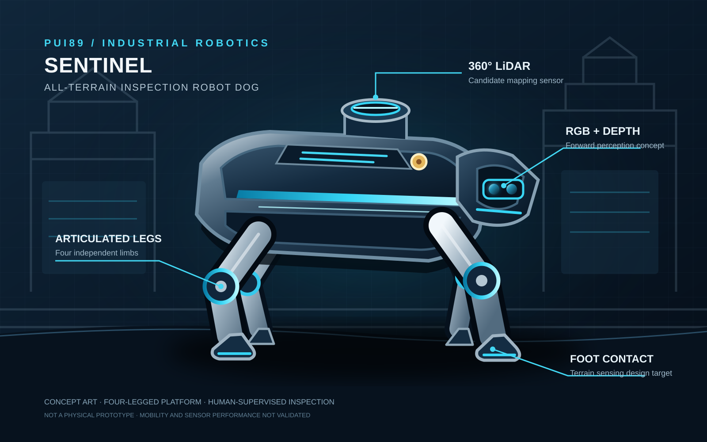

# PUI89 Sentinel — หุ่นยนต์สำรวจและตรวจสอบพื้นที่แบบทุกสภาพภูมิประเทศ

**หุ่นยนต์สี่ขา (Quadruped) สำหรับการสำรวจ การรับรู้สถานการณ์ และการเก็บหลักฐานการตรวจสอบภายใต้การกำกับของมนุษย์**

[English](README.md) · [ภาษาไทย](README.th.md) · [เว็บไซต์ภาษาอังกฤษ](https://pui89.github.io/sentinel.html) · [เว็บไซต์ภาษาไทย](https://pui89.github.io/sentinel-th.html) · [PUI89 Portfolio](https://pui89.github.io/)

*ภาพแนวคิดเท่านั้น ไม่ใช่หลักฐานว่ามีการสร้าง ติดตั้ง ทดสอบ หรือรับรองหุ่นยนต์แล้ว*

## 1. ผลิตภัณฑ์นี้คืออะไร

PUI89 Sentinel เป็นหุ่นยนต์ภาคพื้นดินแบบ **สี่ขา** ที่ออกแบบเพื่อสนับสนุนการตรวจสอบพื้นที่อุตสาหกรรม โครงสร้างพื้นฐาน โลจิสติกส์ และพื้นที่ภายนอกที่ได้รับอนุญาต โดยมนุษย์เป็นผู้กำกับภารกิจและมีอำนาจตัดสินใจขั้นสุดท้าย

## 2. ภารกิจและขอบเขตหน้าที่

ช่วยผู้ปฏิบัติงานสังเกตพื้นที่ที่เข้าถึงได้ยาก รวบรวมข้อมูลและหลักฐานที่ตรวจสอบย้อนกลับได้ และแจ้งข้อสังเกตที่ต้องให้มนุษย์พิจารณา คำว่า All-Terrain เป็นทิศทางการพัฒนา ไม่ใช่การรับประกันว่าสามารถผ่านทุกพื้นผิวหรือพื้นที่อันตรายได้

## 3. ผู้ใช้งานและคุณค่าที่มุ่งส่งมอบ

ผู้ตรวจสอบโรงงาน โครงสร้างพื้นฐาน คลังสินค้า และพื้นที่ที่ได้รับอนุญาต โดยมีเป้าหมายเพื่อเพิ่มการรับรู้สถานการณ์และช่วยจัดเก็บหลักฐานอย่างเป็นระบบ

## 4. ความสามารถเฉพาะผลิตภัณฑ์

- การเคลื่อนที่แบบสี่ขาและการรับรู้สภาพพื้นผิวเป็นหัวข้อวิศวกรรมที่ต้องพิสูจน์
- รวมข้อมูลจากกล้อง เสียง แผนที่ มิติพื้นที่ และเซนเซอร์อื่นที่ได้รับอนุญาตตามภารกิจ
- สนับสนุนบันทึกการตรวจสอบ สัญญาณความผิดปกติ และหลักฐานที่มนุษย์ตรวจทาน
- หากข้อมูลขาดหาย เก่า ขัดแย้ง หรือไม่แน่นอน ให้ระบุว่าไม่ทราบและขอให้ผู้ควบคุมตรวจสอบ
- เลือกเซนเซอร์และอุปกรณ์บรรทุกหลังจากกำหนดภารกิจแรกและประเมินอันตรายแล้ว

## 5. AI และสถาปัตยกรรมความฉลาด

ความสามารถที่อาจจัดสรร ได้แก่ Object Detection, Image Segmentation, Object Tracking, SLAM, Sensor Fusion และ Anomaly Detection สำหรับการตรวจสอบภายใต้การกำกับ รวมถึงโมเดลพยากรณ์และ VLM/LLM สำหรับสรุปหลักฐานให้มนุษย์ตรวจทาน ทั้งหมดเป็นโปรไฟล์ความสามารถที่เสนอ ไม่ใช่หลักฐานว่าติดตั้งหรือทำงานบนหุ่นยนต์จริงแล้ว

## 6. ฮาร์ดแวร์และเซนเซอร์

เป็นแนวคิดหุ่นยนต์สี่ขา ยังไม่มีการยืนยันต้นแบบจริง ชุดเซนเซอร์ที่บูรณาการแล้ว การเดินที่ผ่านการตรวจสอบ หรือการทดสอบภาคสนาม ขนาด น้ำหนัก น้ำหนักบรรทุก ข้อต่อ ระยะก้าว แบตเตอรี่ และสมรรถนะการเคลื่อนที่ยังต้องกำหนดตามภารกิจแรก

## 7. ความปลอดภัย ความเป็นส่วนตัว และความมั่นคงปลอดภัย

ต้องมีการประเมินพื้นที่และอันตรายก่อนภารกิจ การหยุดฉุกเฉิน สถานะปลอดภัยเมื่อระบบหรือการสื่อสารขัดข้อง และขั้นตอนกู้คืนโดยมนุษย์ การใช้ภาพ RGB, Depth หรือ LiDAR เพียงอย่างเดียวไม่สามารถยืนยันว่าบรรยากาศอันตรายปลอดภัยต่อการเข้าไปได้

## 8. สิ่งที่ยังไม่มีหลักฐานยืนยันหรืออยู่นอกขอบเขต

- ยังไม่มีต้นแบบจริง ชุดเซนเซอร์ที่บูรณาการ การเดินที่ผ่านการตรวจสอบ หรือสมรรถนะทุกสภาพภูมิประเทศ
- คำว่า All-Terrain ไม่ใช่การรับประกันการเข้าถึงทุกพื้นที่
- **การตรวจจับสารเสพติด การตรวจด้วย X-ray การระบุสารเคมี และการบังคับใช้กฎหมายอยู่นอกขอบเขต Sentinel ปัจจุบัน** เอกสารเกี่ยวกับการคัดกรองในอดีตเป็นงานเดิม ไม่ใช่ความสามารถของผลิตภัณฑ์ปัจจุบัน
- ห้ามใช้การรับรู้จาก RGB, Depth หรือ LiDAR เพียงอย่างเดียวเพื่อตัดสินใจเข้าพื้นที่ที่อาจมีบรรยากาศอันตราย

## 9. สถานะการพัฒนาและหลักฐาน

**Specified — มีการจัดทำข้อกำหนดผลิตภัณฑ์หุ่นยนต์สี่ขาแล้ว** ยังไม่มีการอ้างว่ามีหุ่นยนต์จริงหรือผ่านการทดสอบภาคสนาม

## 10. ขั้นตอนพิสูจน์ผลถัดไป

เลือกภารกิจตรวจสอบหนึ่งรูปแบบที่มีมนุษย์กำกับ ระบุสถานที่ ผู้ใช้ ขอบเขตการทำงาน อันตราย เซนเซอร์ที่จำเป็น และเกณฑ์ยอมรับที่วัดผลได้ ก่อนเลือกฮาร์ดแวร์

## 11. การเชื่อมต่อกับ Shared AI Core

ใช้สถาปัตยกรรม สัญญาข้อมูล หลักฐาน ความปลอดภัย ความเป็นส่วนตัว การกู้คืน และการโต้ตอบร่วมจาก [PUI89 Shared AI Core](https://github.com/Pui89/PUI89-Shared-AI-Core) ส่วนการเคลื่อนที่สี่ขา อุปกรณ์ตรวจสอบ และความเสี่ยงเฉพาะภารกิจต้องกำหนดและตรวจสอบแยกต่างหาก

## 12. เอกสารและลิงก์โครงการ

- [พิมพ์เขียวระบบฉบับสมบูรณ์ (Complete System Blueprint)](docs/COMPLETE_SYSTEM_BLUEPRINT.md)
- [ตารางเมทริกซ์การตรวจสอบ (Validation Matrix)](docs/VALIDATION_MATRIX.md)
- [แนวคิดและขอบเขต Sentinel](docs/PUI89_SENTINEL_ROBOT_CONCEPT.md)
- [ข้อกำหนดหุ่นยนต์ตรวจสอบแบบสี่ขา](docs/SENTINEL_ALL_TERRAIN_INSPECTION_ROBOT_DOG_REQUIREMENTS_V0.2.md)
- [กรอบวิศวกรรมน้ำหนักเบาถึงสมดุล v0.1](docs/SENTINEL_LIGHTWEIGHT_BALANCED_ENGINEERING_BASELINE_V0.1_TH.md)
- [ทะเบียนการเปลี่ยนขอบเขตงานในอดีต](docs/SENTINEL_SCOPE_MIGRATION.md)

ใช้คำเรียกสถานะตามหลักฐานเท่านั้น ได้แก่ Proposed, Specified, Implemented, Simulated, Software-tested, Bench-tested, Field-tested, Validated, Certified และ Unknown
