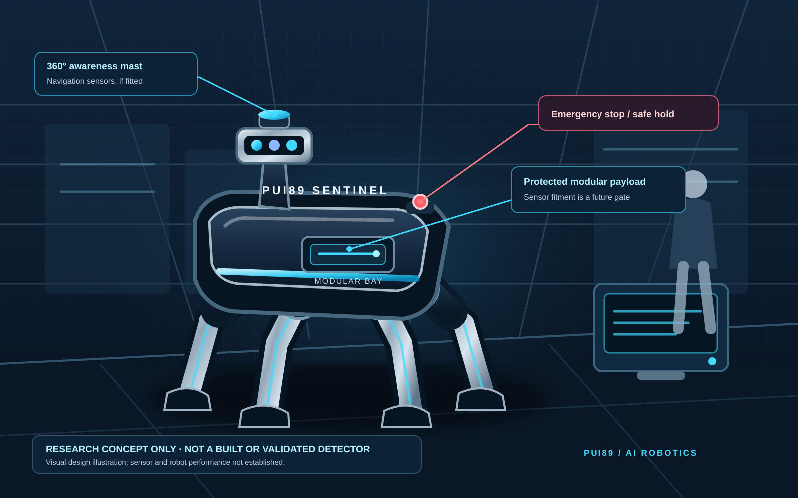

# PUI89 SENTINEL — mobile multimodal inspection robot concept

**Status: PROPOSED DESIGN / SOFTWARE WORKFLOW PROTOTYPE.** This document describes a research concept, not a built robot, validated narcotics detector, certified security product, or operational system.

## 1. Robot form

PUI89 Sentinel is proposed as a compact four-legged mobile inspection assistant for controlled, authorised environments such as a supervised terminal or logistics research site.

- **Body:** low-profile, protected central chassis with rounded external surfaces and guarded joints.
- **Mobility:** four articulated legs for slow, supervised movement; pedestrian-aware yielding and stop-first behaviour are design requirements, not demonstrated capabilities.
- **Awareness mast:** a raised 360-degree sensor position for navigation and scene awareness, subject to the selected hardware.
- **Forward perception:** RGB/depth cameras may support scene understanding and obstacle awareness; ordinary RGB imagery cannot identify chemical composition.
- **Payload bay:** protected, replaceable module bay. X-ray, spectrometric or chemical instruments are not included by default and must not be implied until selected, lawfully operated, calibrated and independently validated.
- **Human interface:** operator console, status indicators, event log, emergency stop and explicit hand-off to an authorised reviewer.

The four-legged shape is a mobility concept, not a claim that quadruped mobility is necessary or safer than a wheeled platform. A later engineering comparison should assess cost, maintainability, stability, accessibility and pedestrian risk before selecting hardware.

## 2. How the proposed system works

1. **Authorised mission setup:** a trained operator defines the permitted area, purpose, time window, data rules and stop conditions. No covert patrol or unrestricted person tracking.
2. **Safe navigation:** the robot receives a bounded route and speed limit. Stale navigation data, blocked paths, a person too close, communications loss or a safety fault leads to slow/stop/safe-hold.
3. **Evidence intake:** only configured and authorised modalities are read. Each observation carries source identity, timestamp, calibration state, quality and provenance.
4. **Independent modality checks:** image, depth, X-ray or analytical sensor streams are assessed separately. A modality that is absent, stale, uncalibrated, out of range or conflicting is marked UNKNOWN/INVALID and is not silently replaced.
5. **Evidence fusion:** only validated, compatible evidence may be combined. The system reports what evidence is present, missing, conflicting and uncertain. RGB appearance alone never confirms a substance.
6. **Human review:** the software may create a neutral review task such as “additional inspection may be required”. It must not label a person guilty or decide that narcotics are present from appearance alone.
7. **Audit and safe exit:** record the input references, timestamps, model/software version, uncertainty, reviewer action and reason. The robot remains stationary or returns to a designated safe point only under a separately validated navigation policy.

## 3. Decision states

| State | Meaning | Permitted response |
|---|---|---|
| UNKNOWN | Missing, stale or insufficient evidence | Ask for a human check; no inference |
| CONFLICT | Modalities disagree | Preserve both records; escalate |
| REVIEW_REQUIRED | A configured rule or validated model warrants attention | Neutral queue for authorised reviewer |
| NO_ALERT | No configured review trigger | Does not certify an item as safe |
| SAFE_HOLD | Navigation, sensor or system safety condition is not met | Stop motion and request operator support |

An AI alert is not proof of narcotics, wrongdoing or legal status. No autonomous accusation, detention, search, seizure, confiscation or enforcement decision is permitted.

## 4. 4D concept sequence

The companion storyboard in [4D video storyboard](4d-video-storyboard.md) describes a 30-second cinematic sequence with time, camera movement, robot movement, environment and interface overlays. It is an animation brief, not a simulation result.

## 5. Safety and privacy boundaries

- No facial recognition, biometric identification, emotion inference, demographic profiling or person scoring.
- No covert recording, unrestricted tracking, or collection beyond the authorised purpose.
- No weapon, restraint, pursuit, physical contact, forced access or autonomous enforcement.
- No chemical identity claim without a suitable validated analytical method, calibration, lawful chain of custody, independent ground truth and qualified human review.
- Emergency stop, speed/force limits, obstacle and pedestrian tests, cybersecurity, battery safety, mechanical risk assessment and operator training are prerequisites before any physical pilot.
- Legal authority, privacy impact, retention, access control and evidence-handling requirements must be reviewed for each jurisdiction.

## 6. Evidence gates

1. **Software prototype:** synthetic tests for provenance, timestamps, modality absence/conflict, uncertainty, abstention, human-review routing and audit integrity.
2. **Simulation-only:** only after a documented simulator and robot model are actually configured; report simulated results as simulation.
3. **Bench integration:** only with selected, documented sensors and safety-reviewed hardware; no public-space operation.
4. **Controlled pilot:** independent validation, lawful approval, human factors and safety review.
5. **Field claims:** only measured results with sample counts, test conditions, false-positive/false-negative analysis, calibration and limitations.

## 7. Evidence labels

Use PROPOSED, IMPLEMENTED, TESTED, SIMULATION-ONLY, MEASURED, VERIFIED and NOT VALIDATED accurately. Passing software tests does not validate chemical sensing, detection accuracy, robot mobility or legal compliance.

## 8. Free-first engineering approach

Start with existing Python checks, synthetic scenarios, diagrams and offline report generation. ROS 2, Gazebo, Blender, FreeCAD and additional model runtimes are optional future tools: check licences, installation size, hardware requirements and cost before use. Do not download model weights, install large stacks, call paid APIs or incur recurring services by default.
