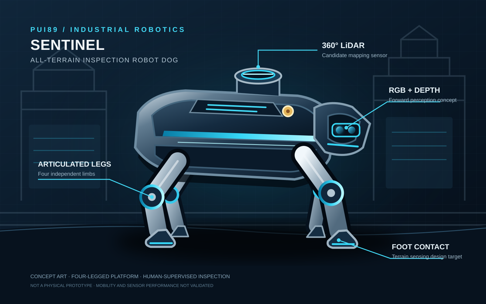

# PUI89 Sentinel — All-Terrain Inspection Robot Dog Concept

**Status:** Product concept and engineering requirements only. No physical robot, integrated sensor stack or validated field capability is claimed.

## 1. Product form

PUI89 Sentinel is a four-legged mobile inspection platform for authorised industrial, infrastructure, logistics, port and selected outdoor environments.

- **Body:** compact protected chassis with guarded joints and serviceable modules.
- **Mobility:** four articulated legs with controlled gait, foot placement and supervised recovery.
- **Perception:** candidate RGB, depth and 360-degree LiDAR sensing for scene context, geometry and obstacle awareness.
- **State sensing:** IMU, joint-state and foot-contact signals for body and locomotion estimation.
- **Optional mission sensing:** thermal, audio or calibrated environmental instruments only when justified by the mission risk assessment.
- **Operator interface:** mission setup, live status, evidence review, alerts, safe hold and emergency-stop status.

The quadruped form is a design direction. Cost, stability, maintainability, accessibility, payload and safety must be compared against alternatives before hardware selection.

## 2. Inspection workflow

1. An authorised operator defines the mission, permitted area, time window, task and stop conditions.
2. The system checks robot health, sensor availability, calibration and communications.
3. Perception builds a timestamped world state with source provenance and uncertainty.
4. The task supervisor assesses obstacles, terrain, access geometry and retreat options.
5. The system proposes a bounded inspection action.
6. An independent deterministic safety gate checks permissions, localisation, collision clearance, footing, speed/force limits and hardware status.
7. The operator approves consequential actions and reviews observations.
8. Evidence is stored with sensor/configuration, timestamp, software/model version and reviewer notes.
9. Unknown or unsafe conditions result in STOP, SAFE_HOLD, retreat or operator escalation.

## 3. Intelligence layers

- **Vision:** image quality, detection, classification, tracking, segmentation, scene understanding and visible change cues.
- **Spatial:** depth, mapping, localisation, geometry and traversability estimation where supported by calibrated sensors.
- **Multimodal:** evidence alignment, sensor health, missing-data handling, disagreement and uncertainty.
- **Task:** mission decomposition, checklist progression, route proposals and completion evidence.
- **Robotics:** body-state estimation, gait and foot-placement proposals, obstacle awareness and recovery planning.
- **Safety:** permissions, independent limits, fault detection, safe hold, human approval and emergency-stop policy.

These are target capabilities, not claims of implementation or validation.

## 4. Decision states

| State | Meaning | Required response |
|---|---|---|
| UNKNOWN | Evidence or critical state is missing or insufficient | Abstain and request review |
| CONFLICT | Sensors or system states disagree | Preserve evidence and escalate |
| REVIEW_REQUIRED | An observation needs operator assessment | Present a neutral review item |
| NO_ALERT | No configured review trigger was raised | Do not infer that the environment is risk-free |
| SAFE_HOLD | A safety condition is missing, invalid or failed | Block motion and request operator support |

## 5. Safety and privacy

- No autonomous enforcement, coercive action or person scoring.
- No biometric identity inference.
- No covert recording or collection beyond the authorised mission.
- People and vehicles are dynamic obstacles; site exclusion rules apply.
- AI proposals cannot override the independent safety controller.
- Loss of localisation, unsafe footing, stale sensing, sensor disagreement or communications failure must trigger a defined safe response.
- Apply data minimisation, access controls, retention limits and audit logging.

## 6. Evidence gates

1. **Requirements:** mission definition, hazards, operating envelope and measurable acceptance criteria.
2. **Simulation:** repeatable gait, terrain, obstacle, localisation and fault scenarios.
3. **Bench integration:** documented sensors, power, compute, thermal and communications checks.
4. **Controlled mobility:** stability, payload, stopping, recovery and emergency-stop validation.
5. **Supervised site trial:** site permission, safety review, operator training and recorded acceptance.
6. **Public claims:** only reproducible results with configuration, sample counts, conditions, metrics and limitations.

Simulation results are not proof of physical performance.

## 7. Open-source and low-cost development

Prefer documented open-source tools and existing local/GitHub workflows. Check licence, provenance, hardware requirements, installation size and compatibility before adopting any dependency. Do not download large models, install additional stacks, procure hardware or incur paid services without separate approval.
